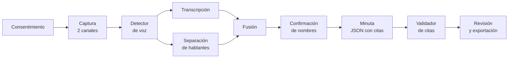

# AI Opportunity Canvas — Generador local de minutas de reuniones

> **Integrantes:** Luisa, Bruno, Matías, Felipe.
> **Versión:** 4 · **Fecha:** 2026-10-12
> **Alcance:** producto en castellano. Se evalúa por módulo: transcripción,
> separación de hablantes y minuta ([Hito 2](hito-2/README.md)).
>
> Versión 1 (Hito 1): [HomeMatch AI](propuesta-3.md). Texto corto de esta idea: [propuesta-2.md](propuesta-2.md).

---

## 1. Problema y contexto

### A quién le pasa

Quien coordina reuniones de trabajo por videollamada y tiene que dejar
asentado qué se decidió, en organizaciones donde lo que se dice es
confidencial (estudios jurídicos, salud, finanzas, sector público).

### Qué le pasa

> "O participo o anoto. A la noche no me acuerdo quién se comprometió a qué.
> Las herramientas que lo hacen solas están prohibidas acá: mandan el audio a
> un tercero y meten un bot en la llamada."

### Cuánto le cuesta

| Proxy | Dato | Fuente |
|---|---|---|
| Volumen de reuniones | 3 veces más reuniones por semana que en 2020 | Microsoft Work Trend Index 2023 [1] |
| Herramientas no aprobadas | 78% de quienes usan IA en el trabajo llevan las suyas | Microsoft/LinkedIn 2024 [2] |
| Costo legal | Demandas colectivas contra Otter.ai y Fireflies.ai (2025) | [3][4] |

Sin medir todavía: cuánto lleva escribir una minuta a mano.

### Evidencia

- **Confirmación:** demandas y guías profesionales contra los asistentes en la nube [3][4][5]; alternativas locales con tracción (Meetily, ~31.000 estrellas [6]).
- **Refutación:** Copilot en Teams procesa dentro de Microsoft 365 [7]; para quien ya lo paga, lo local puede no agregar nada. Sin entrevistas propias.

---

## 2. Stakeholders

| Papel | Quién es | Qué necesita ver para decir que sí |
|---|---|---|
| Usuario | Quien coordina la reunión | Minuta correcta; corregirla es rápido |
| Influenciador | IT | Se instala sin permisos especiales; no abre conexiones |
| Recomendador | Compliance / Legal | El audio no sale del equipo; consentimiento, retención y borrado |
| Comprador | Jefe de área | Horas recuperadas |
| Decisor | Seguridad / dirección | Auditoría aprobada |
| Saboteador | IT con Copilot ya pago; participantes que no quieren ser grabados | — |

### Evidencia

- **Confirmación:** los colegios de abogados ya regulan estas herramientas [5].
- **Refutación:** no hablamos con compliance ni con IT.

---

## 3. Hipótesis de solución

### Descripción del producto

Aplicación de escritorio. Graba la reunión sin sumarse a la llamada y, al
terminar, en la misma computadora y sin conexión:

1. Transcribe y separa quién habló.
2. El usuario confirma el nombre de cada voz.
3. Escribe la minuta: decisiones, compromisos (quién, qué, cuándo) y
   preguntas abiertas, cada ítem con la cita que lo respalda.
4. El usuario revisa y exporta. El audio se borra.

### Acción · Predicción · Juicio

| | |
|---|---|
| **Acción** | El usuario participa en vez de anotar, y envía la minuta minutos después de terminar |
| **Predicción** | Qué se dijo, quién lo dijo, y qué frases son decisiones o compromisos |
| **Juicio** | Inventar un compromiso es peor que omitirlo. Atribuir una frase a otra persona es grave: ante la duda, "hablante no identificado" |

### Criterios de aceptación

| # | Criterio | Verificación |
|---|---|---|
| A1 | Nada sale del equipo | Monitor de red durante el procesamiento |
| A2 | Todo ítem tiene una cita que existe en la transcripción | Prueba automática |
| A3 | 1 hora de reunión se procesa en ≤ 30 min sin placa de video | Cronómetro |
| A4 | No se graba sin el aviso de consentimiento | Prueba de interfaz |

### Sin modelo

Separar al usuario de los demás (dos canales de audio), nombrar las voces (lo
hace el usuario), validar citas (regla), exportar (plantilla).

### Evidencia

- **Confirmación:** transcribir y separar hablantes en local ya existe (noScribe [8]). Cada módulo tiene datos para evaluarse ([EDA](hito-2/2-eda-de-viabilidad.md)).
- **Refutación:** la separación de hablantes se equivoca en ~17–20% del tiempo en AMI [9], y Whisper inventa frases en ~1% de las transcripciones [10].

---

## 4. Alternativas y statu quo

**Hoy:** notas a mano, otra persona que anota, o nada.

| Categoría | Ejemplos | Bot | Procesa en | Comentario |
|---|---|---|---|---|
| Nube | Otter, Fireflies | Sí | Nube | Demandadas [3][4] |
| Integradas | Copilot en Teams, Gemini en Meet | No | Nube del proveedor | El competidor más fuerte [7] |
| Sin bot | Granola | No | Nube | No resuelve la confidencialidad |
| Locales | Meetily [6], noScribe [8] | No | Local | Competencia directa |

**Diferencial:** minuta con cita por ítem, hablantes confirmados por el
usuario, consentimiento y borrado incluidos, y resultados medidos y
publicados.

### Evidencia

- **Confirmación:** la competencia local existe.
- **Refutación:** no probamos Meetily ni noScribe.

---

## 5. Hipótesis de datos

No se entrena ningún modelo. Los datos son el conjunto de evaluación, uno por
módulo. Detalle en el [mapa de fuentes](hito-2/1-mapa-de-fuentes.md).

| Módulo | Dato | Origen | ¿Público? | ¿Lo vimos? | ¿Sensibles? | Sesgo conocido | Comentarios |
|---|---|---|---|---|---|---|---|
| Transcripción | OpenSLR 61 | Google | CC BY-SA 4.0 | Sí | Voz anónima | Lectura; solo Buenos Aires; 70% mujeres | 8,0 h, 44 hablantes |
| Transcripción | CORdeBA | UNLP | CC BY-NC-SA 4.0 | Sí | Conversaciones privadas | Hablantes jóvenes | 6,4 h espontáneas, sin tiempos |
| Transcripción | Humyn LATAM | Humyn Labs | CC BY 4.0 | Sí | Voz | Muestra comercial | 2 grabaciones argentinas (31 min), con tiempos |
| Transcripción | Common Voice 26 rioplatense | Mozilla | CC0 | No (pide cuenta) | Voz | Lectura | ~16 h según su ficha |
| Hablantes | AMI, ICSI | Univ. de Edimburgo, ICSI | CC BY 4.0 | Sí | Voz | Inglés; presencial; 2001–2005 | 246 reuniones, 171,7 h; 91 no vistas por pyannote |
| Hablantes | VoxConverse | Univ. de Oxford | CC BY 4.0 | Sí | — | Videos de YouTube | 448 sesiones |
| Minuta | AMI (minutas y evidencias) | Univ. de Edimburgo | CC BY 4.0 | Sí | — | Inglés; 97% de reuniones actuadas | 142 minutas; 90,5% de los ítems con evidencia |
| Minuta | AMI traducido al castellano | Sintético, derivado | — | No existe | — | Castellano de traductor | Transcripción y minuta |
| Punta a punta | Reuniones propias en castellano | El equipo | No | No existe | Voz | 4 personas | 10 reuniones, anotadas como AMI |

### Evidencia

- **Confirmación:** 10 de 25 niveles cumplidos; cada módulo tiene al menos una fuente utilizable.
- **Refutación:** 0 reuniones en castellano con audio, transcripción, hablantes y minuta. 0 minutas en castellano. Solo el 46% del audio rioplatense es espontáneo.

**Veredicto del Hito 2:** [ajustar el alcance](hito-2/4-veredicto.md).

---

## 6. Métrica de éxito

| | |
|---|---|
| **Métrica de negocio** | Tiempo desde que termina la reunión hasta que la minuta está lista para enviar |
| **Umbral** | ≤ 10 min de revisión en ≥ 70% de las reuniones de 1 hora; ≤ 30 min de procesamiento por hora, sin placa de video |
| **Cómo se mide** | Línea de base: cronometrar la minuta manual 2 semanas. Después, lo mismo con el prototipo |
| **Proxy técnico** | Por módulo: error por palabra (transcripción, castellano); error de diarización (91 reuniones de AMI e ICSI); minuta: cobertura contra la referencia, citas válidas y un LLM como juez calibrado contra anotación humana (AMI traducido) |
| **Qué se registra** | Correcciones del usuario y tiempo de revisión, en local |

### Evidencia

- **Confirmación:** las métricas técnicas tienen referencias publicadas [9][10].
- **Refutación:** los resultados sobre audio de sala, lectura o texto traducido pueden no valer para reuniones reales en castellano.

---

## 7. Riesgos éticos y de sesgo (preliminar)

| Familia | Riesgo | Decisión de diseño |
|---|---|---|
| Asignación | Atribuir un compromiso a quien no lo asumió | Cita por ítem; "hablante no identificado"; revisión humana |
| Calidad de servicio | Peor resultado para quienes pesan menos en los datos: hablantes de fuera de Buenos Aires, mayores de 50 | Medir el error por grupo; declarar para quién no se probó |
| Representación | La minuta reescribe lo que cada uno dijo | La cita muestra el texto original |
| Interpersonal | Grabar sin que los demás se enteren | Aviso de consentimiento obligatorio; indicador visible; borrado del audio |
| Social | Si todo se transcribe, se habla con menos franqueza | Opción de guardar solo la minuta |

**Regulación:** consentimiento para captar la voz (Código Civil y Comercial,
art. 53). No se guardan huellas de voz [4]. Sin análisis de emociones [11].

**No usar para:** grabar sin avisar; evaluar empleados; usar la minuta como
prueba sin revisión.

---

## 8. Partes, pipeline y tecnologías



| # | Parte | Qué hace | Modelo / regla | Tecnología candidata | Licencia |
|---|---|---|---|---|---|
| 1 | Consentimiento | Aviso y registro de aceptación | Regla | Interfaz propia | — |
| 2 | Captura | Micrófono y audio del sistema por separado | Regla | PipeWire; o entrada por archivo | — |
| 3 | Detector de voz | Marca dónde hay habla | Modelo chico | Silero VAD | MIT |
| 4 | **Transcripción** | Audio → palabras con tiempos | **Modelo** | Whisper large-v3-turbo con faster-whisper | MIT |
| 5 | **Separación de hablantes** | Quién habla cuándo | **Modelo** | pyannote community-1 | CC BY 4.0 |
| 6 | Fusión | Asigna cada palabra a un turno | Regla | Código propio | — |
| 7 | Confirmación | El usuario nombra cada voz | Humano | Interfaz propia | — |
| 8 | Minuta | Turnos → decisiones y compromisos con citas | **Modelo** | Modelo abierto de 7–14 mil millones de parámetros, con Ollama, salida en JSON | Según modelo |
| 9 | Validador | Verifica que cada cita exista | Regla | Código propio | — |
| 10 | Revisión y exportación | Editar y exportar | Humano | Interfaz web local | — |
| 11 | Evaluación | Corre las métricas sobre el conjunto congelado | Regla | Código propio | — |

Cada módulo con modelo (4, 5 y 8) se evalúa por separado, con su propia
fuente. El producto completo, con reuniones propias.

**Contratos entre partes:**

```json
{"turnos": [{"id": "t12", "hablante": "S1", "inicio": 132.4, "fin": 142.1, "texto": "..."}],
 "minuta": {"decisiones": [{"texto": "...", "citas": ["t12"]}],
            "compromisos": [{"quien": "S1", "que": "...", "para_cuando": "...", "citas": ["t40"]}]}}
```

**Equipo de cómputo:** mínimo, laptop de 16 GB sin placa de video. Desarrollo:
12 hilos, 32 GB, RTX 3050 de 6 GB.

---

## Bitácora de revisiones

| Fecha | Sección | Qué cambió | Qué lo motivó |
|---|---|---|---|
| 2026-09-28 | Todas | Versión 1: HomeMatch AI ([propuesta-3.md](propuesta-3.md)) | Hito 1 |
| 2026-10-09 | Todas | Cambio de problema: generador local de minutas | Decisión del equipo |
| 2026-10-10 | 3, 5, 6, 8 | Alcance: solo inglés; datos solo para transcribir y separar hablantes | Decisión del equipo |
| 2026-10-10 | 5, 6 | Evaluación sobre 91 reuniones; videollamada aparte | Veredicto del Hito 2 |
| 2026-10-11 | 6 | Se suma la evaluación de la minuta con AMI | Felipe: niveles M1 a M3 |
| 2026-10-12 | 3, 5, 6, 7, 8 | El alcance vuelve a castellano. Evaluación por módulo; AMI traducido para la minuta; reuniones propias para el producto completo | Decisión del equipo; [veredicto del Hito 2](hito-2/4-veredicto.md) |

## Referencias

1. Microsoft, *Work Trend Index 2023* — https://www.microsoft.com/en-us/worklab/work-trend-index/will-ai-fix-work
2. Microsoft y LinkedIn, *2024 Work Trend Index* — https://news.microsoft.com/source/2024/05/08/microsoft-and-linkedin-release-the-2024-work-trend-index-on-the-state-of-ai-at-work/
3. *Brewer v. Otter.ai* (2025) — https://www.npr.org/2025/08/15/g-s1-83087/otter-ai-transcription-class-action-lawsuit
4. *Cruz v. Fireflies.AI Corp.* (2025) — https://www.ebglaw.com/insights/publications/ai-meeting-assistants-and-biometric-privacy-lessons-from-the-fireflies-ai-lawsuit
5. NYC Bar Association, *Formal Opinion 2025-6* — https://www.nycbar.org/reports/formal-opinion-2025-6-ethical-issues-affecting-use-of-ai-to-record-transcribe-and-summarize-conversations-with-clients/
6. Meetily — https://github.com/Zackriya-Solutions/meetily
7. Microsoft Learn, *Data, Privacy, and Security for Microsoft 365 Copilot* — https://learn.microsoft.com/en-us/microsoft-365/copilot/microsoft-365-copilot-privacy
8. noScribe — https://github.com/kaixxx/noScribe
9. pyannote, *speaker-diarization-community-1* — https://huggingface.co/pyannote/speaker-diarization-community-1
10. Koenecke et al., *Careless Whisper: Speech-to-Text Hallucination Harms*, FAccT 2024 — https://arxiv.org/abs/2402.08021
11. FPF, *Red Lines under EU AI Act: emotion recognition in the workplace* — https://fpf.org/blog/red-lines-under-eu-ai-act-unpacking-the-prohibition-of-emotion-recognition-in-the-workplace-and-education-institutions/
