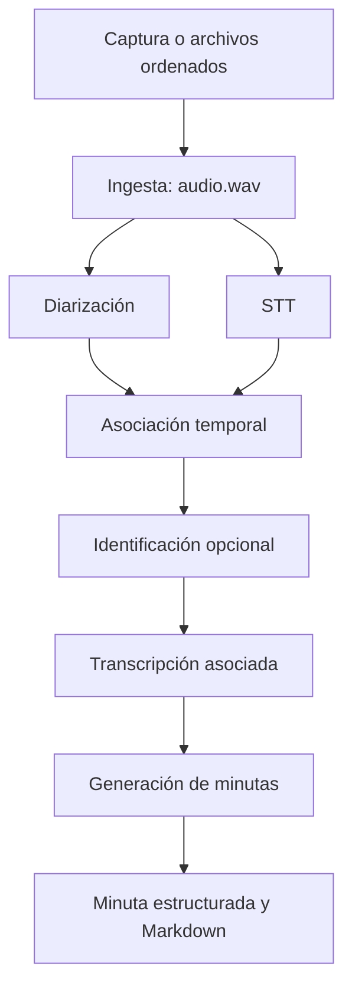

# Arquitectura y decisiones de integración de la PoC

## Alcance y referencias

La prueba de concepto integra captura o carga de audio, diarización, reconocimiento del habla, asociación temporal con identificación opcional de hablantes y generación de minutas en castellano. La [definición del Hito 3](../hito-3/definicion-de-la-poc.md) establece el problema, las decisiones originales y los criterios de aceptación. Este documento describe las decisiones de implementación posteriores y complementa esa especificación; no redefine sus umbrales.

La unidad de procesamiento es una reunión. La aplicación dispone de un recorrido completo con modelos reales, también utilizable desde Python y terminal. Se conserva el objetivo de confidencialidad. El entrenamiento de modelos, la adaptación terminológica, la integración directa con plataformas de videollamada, la captura multicanal específica y la edición de turnos no se incorporan a esta PoC. La evaluación formal y la selección definitiva de modelos son tareas distintas del cierre funcional.

## Estructura y responsabilidades

| Componente | Responsabilidad | Artefactos principales |
|---|---|---|
| [`src/captura`](../src/captura/) | Grabación de micrófono y sistema; recuperación de archivos interrumpidos | WAV y reporte de captura |
| [`src/ingesta`](../src/ingesta/) | Normalización, orden, copias verificables y correspondencia temporal | `audio.wav`, `ingesta.json` |
| [`src/diarizacion`](../src/diarizacion/) | Turnos y etiquetas de hablantes, conservando solapamientos | `diarization.json`, `diarization.meta.json` |
| [`src/stt`](../src/stt/) | Texto en castellano y tiempos de segmentos y palabras | `asr.json` |
| [`src/asociacion`](../src/asociacion/) | Atribución temporal, incertidumbre y modelo de identificación humana | `transcription.json`, `transcription.meta.json`, `speakers.json` cuando corresponde |
| [`src/minutas`](../src/minutas/) | Extracción, consolidación y presentación del contenido solicitado | `minutes.json`, `minutes.md`, `ejecucion_minutas.json` |
| [`src/pipeline`](../src/pipeline/) | Configuración, orquestación, exclusión, vigencia y continuidad | `workflow.json` y eventos de progreso |
| [`src/interfaz`](../src/interfaz/) | Interacción, captura, selección de parámetros, fichas y visores | Consume la API y los eventos del pipeline |

Los nombres y rutas compartidos se centralizan en [`src/rutas.py`](../src/rutas.py). Los componentes conservan sus validadores y responsabilidades específicas. Los contratos ejecutables de cada etapa, no las tablas de orientación de este documento, determinan si una salida es válida.

## Núcleo único y ejecución

Se adoptó un workflow fijo de etapas con dependencias explícitas, antes que un agente autónomo, un servicio distribuido o varios scripts independientes coordinados exclusivamente por la GUI. La secuencia y las condiciones de intervención humana son conocidas; no se necesita que un modelo decida qué herramienta ejecutar. El diseño permite medir módulos por separado, comprobar contratos, detener el avance ante fallos y reutilizar resultados válidos. No requiere servidor HTTP, broker ni base de datos.

La API pública de `src.pipeline` no depende de Qt. La CLI mínima satisface la modalidad no gráfica del Hito 3 y transporta eventos al trabajador de la interfaz; el notebook integral utiliza la misma API. No se mantienen pipelines alternativos para cada cliente. Se reutilizaron las implementaciones previas de las etapas y las fichas de hablantes, en vez de sustituirlas por una implementación monolítica.

PySide6 utiliza `QProcess` para ejecutar el pipeline con el mismo intérprete; las inferencias de diarización, STT y minutas se ejecutan en procesos separados y de forma secuencial dentro de una reunión. Frente a mantener todos los modelos cargados en un proceso, se reduce la competencia por VRAM y se evita mantener modelos acústicos durante la respuesta humana. El aislamiento también permite atender eventos y cancelación sin bloquear la ventana. El arranque de procesos añade latencia; la liberación efectiva de recursos y la compatibilidad del hardware de referencia requieren medición. El servicio Ollama tiene un ciclo de vida independiente del proceso Python. Véanse [orquestación](orquestacion.md), [continuidad y confidencialidad](continuidad-y-confidencialidad.md) y [diseño de interfaz](interfaz-y-presentacion.md).

## Señal de entrada y asociación

Se conserva la captura mixta de una sola pista, sin exigir pistas de cada participante o integración específica con aplicaciones de reunión. La alternativa de pistas separadas permitiría aprovechar información por canal y tratar el eco, pero ampliaría el contrato de captura y las decisiones de procesamiento. Sus limitaciones están en [captura](captura/README.md).

Las fuentes seleccionadas se normalizan con FFmpeg a PCM16 mono de 16 kHz y se concatenan en el orden indicado, sin pausas artificiales entre cortes. Se utiliza la cantidad real de muestras para identificar límites, duración y offsets, en vez de sumar duraciones redondeadas. Se conserva la identidad y huella de las fuentes, y copias verificables cuando corresponde. Una colección de cortes no se interpreta como reuniones independientes. Esta decisión no permite inferir la duración de un intervalo no grabado ni garantiza continuidad temporal del evento real.

Diarización y STT reciben el mismo audio normalizado, sin que los turnos de diarización determinen los fragmentos a transcribir. Transcribir el audio completo preserva el contexto lingüístico y permite evaluar ambos módulos de forma independiente. Se asume el costo de asociar después sus tiempos y de representar casos ambiguos. Esta preferencia no está sustentada en una comparación controlada de precisión entre estrategias en la PoC. Véanse [STT](stt/README.md), [asociación](asociacion/README.md) y [temporalidad](temporalidad-transcripcion.md).

La identificación humana se desacopla de la diarización y de STT: se conservan las etiquetas técnicas y se pueden asignar nombres mediante fragmentos de audio. Los nombres no constituyen reconocimiento biométrico. Se admiten nombres vacíos o repetidos; las ejecuciones no gráficas pueden omitir la identificación. Reetiquetar modifica la salida dependiente sin repetir inferencias acústicas vigentes. Persistir la pausa permite continuar sin mantener cargados los modelos. No se garantiza que una etiqueta corresponda a una única persona real si la diarización se equivocó.

## Persistencia y trazabilidad

Se adoptó una carpeta por reunión con un manifiesto de ejecución, frente a crear una carpeta por intento, almacenar únicamente la minuta o generar un archivo persistente por evento. La ruta predeterminada depende de las identidades ordenadas de las fuentes; una ruta explícita permite elegir el destino. Las salidas operativas, los originales personales y los datos de acceso no son artefactos versionables. Los resultados publicados de evaluación se mantienen separados.

La unidad de reutilización es la etapa, no un archivo aislado. La consulta de resultados y los reintentos validan dependencias, contratos y hashes según el diseño del [orquestador](orquestacion.md). Esto limita las inferencias repetidas y las transferencias, pero no implica transacciones multiarchivo ni reproducibilidad bit a bit de los modelos. La política de recuperación y autorización se documenta en [continuidad y confidencialidad](continuidad-y-confidencialidad.md).

## Modelos y contenido de minutas

Se mantiene como baseline académico el conjunto definido en el [Hito 3, sección 3.1.1](../hito-3/definicion-de-la-poc.md#311-el-modelo): pyannote `speaker-diarization-community-1`, Whisper `medium` y Qwen 2.5 7B mediante Ollama local. La elección se apoya en el alcance, la disponibilidad y las restricciones de memoria discutidas en la especificación; no en una comparación exhaustiva realizada después de la integración.

La actualización de diseño del 13/11/2026 permite ensayar también proveedores externos para las minutas, sin abandonar la motivación de confidencialidad del producto. Todos los modelos de minutas admitidos son experimentales; los externos ofrecen capacidad adicional sin requerir que el modelo resida en el equipo. No se supone equivalencia de latencia, calidad, recursos ni privacidad con una hipotética ejecución local. La autorización se vincula al destino y a la solicitud que efectivamente transmite datos. No se envía el WAV desde minutas ni se permite un fallback remoto implícito. El catálogo y los contratos de secciones se mantienen en el código, con una sola fuente de configuración para los clientes. La selección determina qué se pide y valida, no solo qué se muestra. Véanse [generación de minutas](minutas/README.md) y [confidencialidad](continuidad-y-confidencialidad.md).

## Entorno y organización del repositorio

Se consolidaron las dependencias directas en `pyproject.toml` y las restricciones compatibles en `constraints.txt`. Un único entorno Python 3.12, instalado mediante pip, cubre el desarrollo integrado, las pruebas, las evaluaciones, los notebooks y los procedimientos de datos previos. Frente a un entorno por etapa, se evitan instalaciones divergentes, adaptadores dependientes de intérpretes ajenos y duplicación de bibliotecas. La separación de inferencias se realiza mediante procesos, no mediante entornos distintos. La solución aumenta el conjunto de dependencias de una instalación completa; no se han certificado todas las combinaciones de sistema y hardware.

Los perfiles CPU y CUDA 12.8 seleccionan los wheels de PyTorch correspondientes sin bifurcar el código; las bibliotecas nativas, dispositivos y credenciales siguen dependiendo del equipo. Se preservaron las restricciones verificadas y se incorporó un verificador general. No se trata de un lock exhaustivo para todas las plataformas. La [instalación y ejecución](../README.md#entorno-único-para-todo-el-repositorio) son la guía canónica; la [validación de integración](validacion-integracion.md) distingue lo probado de lo pendiente.

La organización directa de paquetes bajo `src/` conserva los imports existentes y evita un segundo nivel de empaquetado innecesario. Se retiraron los módulos obsoletos del árbol activo y se eliminaron imports dependientes de rutas históricas de etapas. Se separaron las pruebas en `tests/`, las herramientas y evidencias de evaluación en `evaluacion/`, los clientes de análisis en `notebooks/` y la documentación técnica en `docs/`. Los entregables de Hito 2 y Hito 3 conservan sus contenidos y el Hito 2 mantiene sus propios scripts y pruebas reproducibles. La estructura anterior se recupera desde el historial Git; las reglas de exclusión protegen archivos locales remanentes en copias antiguas sin reincorporarlos al código activo.

## Validación y cuestiones abiertas

La [validación de integración](validacion-integracion.md) registra las comprobaciones funcionales, los recorridos con modelos reales, las pruebas automatizadas y sus limitaciones. Todavía corresponde evaluar calidad semántica, funcionamiento modular, latencia en el equipo objetivo, escenarios y recuperación conforme a los criterios del Hito 3. Son cuestiones de evaluación, no nuevas definiciones de requisitos. La calidad de atribución y la preservación del texto sin tiempos válidos, la fidelidad de minutas extensas y la portabilidad requieren evidencia y, en su caso, refinamiento. No se declara un veredicto GO a partir de la sola existencia de la aplicación o del número de pruebas aprobadas.
