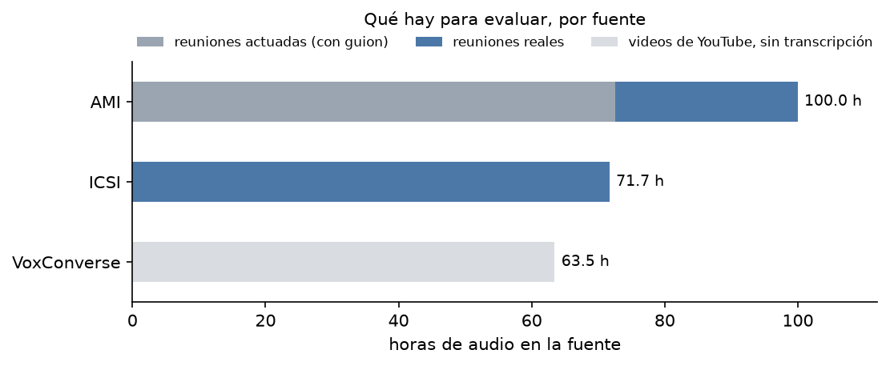
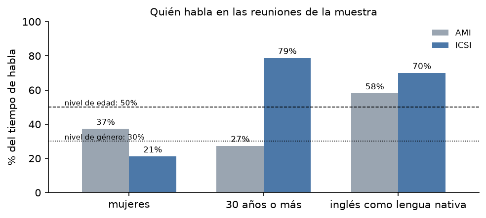
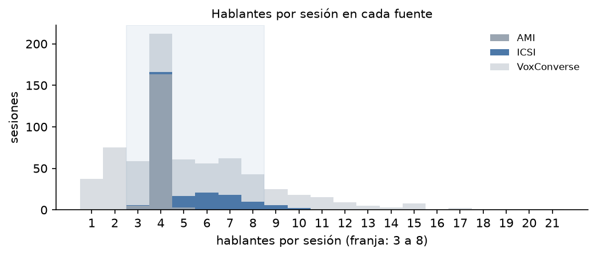
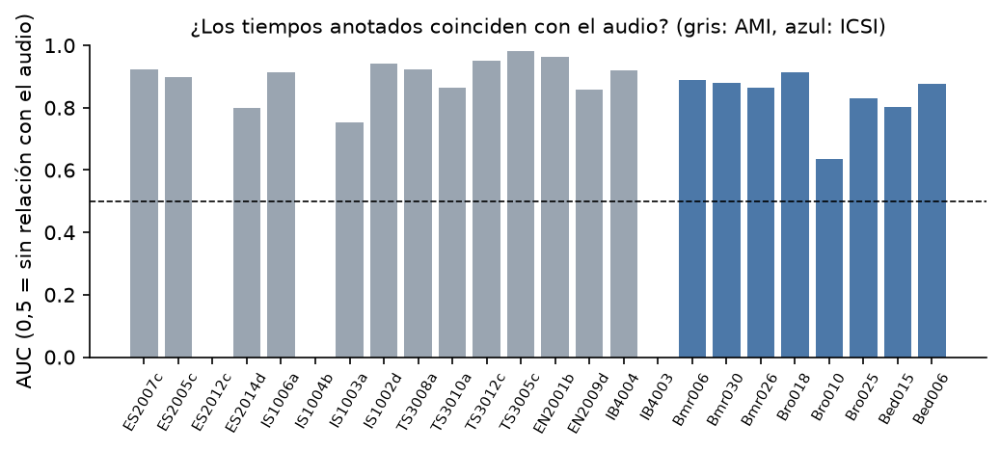

# EDA de viabilidad

**Documento 2 de 4 del [Hito 2](README.md)**

**Equipo:** Luisa, Bruno, Matías, Felipe.

**Muestra:** [`hito-2/muestra/`](muestra/) · **Notebook:** [`hito-2/notebooks/eda_viabilidad.ipynb`](notebooks/eda_viabilidad.ipynb)

**Alcance:** reuniones en inglés; transcribir y separar hablantes. Los datos
son el conjunto de evaluación: no se entrena ningún modelo.

**Resultado:** de 20 niveles, 14 se cumplen, 3 no, 2 en parte y 1 está
pendiente. "Celda" es el identificador de la celda del notebook.

---

## 1. Requerimientos: el nivel que el producto necesita

Fijados en [`niveles-a-priori.md`](niveles-a-priori.md).

| Propiedad | Nivel que el producto necesita | De dónde sale |
|---|---|---|
| Volumen | **V1** ≥ 3 h y ≥ 30 hablantes transcriptos. **V2** ≥ 1 h de habla espontánea. **V3** ≥ 20 sesiones y ≥ 3 h con turnos con tiempos. **V5** ≥ 10 reuniones de ≥ 20 min con audio, transcripción y hablantes | Medir el error por palabra con ±1 punto y el error de diarización promediando varias sesiones |
| Completitud | **C1** transcripción en ≥ 99% de los audios. **C2** hablante en ≥ 95% de los turnos. **C5** género, edad y acento en ≥ 70% de los hablantes de una fuente | Canvas §3 y §7 |
| Corrección | **K1** duplicados ≤ 1%. **K2** cero turnos con fin ≤ inicio. **K3** ≥ 99% de los audios legibles y con la duración declarada. **K4** ≤ 1% de textos con caracteres ajenos | Las métricas comparan texto y tiempos |
| Vigencia | **G1** ≥ 80% de las horas de 2015 en adelante. **G2** al menos una fuente de videollamada | El producto graba reuniones virtuales |
| Representatividad | **R1** ningún género bajo el 30%. **R2** ≥ 50% del habla de personas de 30 o más. **R3** ≥ 50% espontáneo. **R4** ≥ 50% de las sesiones con 3 a 8 hablantes. **R6** ≥ 30% de las horas de reuniones reales | Canvas §1: profesionales en reuniones de trabajo |
| Confiabilidad | **F1** transcripción hecha por personas. **F3** ≤ 2% de desacuerdo entre dos transcriptores del equipo | El error de la referencia tiene que ser menor que el que se mide |

## 2. Resultados de la verificación

| Id | Medido o estimado | Resultado | Celda | Si es estimado, procedencia | Cumple |
|---|---|---|---|---|---|
| V1 | Medido | 171,6 h transcriptas, 250 hablantes, 1.794.240 palabras (AMI 100,0 h; ICSI 71,7 h) | `V1` | — | Sí |
| V2 | Medido | 164,0 h de habla espontánea efectiva | `V2` | — | Sí |
| V3 | Medido | 694 sesiones, 235 h (AMI 171, ICSI 75, VoxConverse 448) | `V3` | — | Sí |
| V5 | Medido | 222 reuniones de ≥ 20 min con audio, transcripción y hablantes (148 AMI, 74 ICSI) | `V5` | — | Sí |
| C1 | Medido | 100% de los 246 audios con transcripción. Palabras sin tiempo: 0,0% en AMI, 11,5% en ICSI | `C1` | — | Sí |
| C2 | Medido | 100% de los turnos con hablante | `C2` | — | Sí |
| C5 | Medido | Género, edad y lengua nativa: 75,0% de los hablantes de ICSI; 64,7% de los de AMI | `C5` | — | Sí (ICSI) |
| K1 | Medido | 0 duplicados | `K1` | — | Sí |
| K2 | Medido | 2 turnos con fin ≤ inicio (AMI); 6 terminan después del audio | `K2` | — | **No**: se descartan por regla |
| K3 | Medido | Audio disponible: 246 de 246. Cubre todos los turnos en 99,4% (AMI) y 98,7% (ICSI). 24 de 24 extractos coinciden con el índice. Los metadatos de AMI declaran bien la duración solo en el 80,1% | `K3` | — | **Parcial**: se usa la duración del audio |
| K4 | Medido | Caracteres ajenos: 0,0% (AMI) y 0,4% (ICSI) de los turnos | `K4` | — | Sí |
| G1 | Medido | 0% posterior a 2015: AMI es de 2004–2005 e ICSI de 2001–2002 | `G1` | — | **No** |
| G2 | Estimado | 0 de 3 fuentes son de videollamada | `G2` | Documentación de las fuentes | **No** |
| R1 | Medido | Mujeres: 37,2% del habla en AMI; 21,1% en ICSI | `R1` | — | **Parcial**: no ICSI |
| R2 | Medido | 52,1% del habla es de personas de 30 o más (AMI 27,3%; ICSI 78,8%) | `R2` | — | Sí |
| R3 | Medido | 97,9% espontáneo (el resto: lectura de dígitos en ICSI) | `R3` | — | Sí |
| R4 | Medido | 71,0% de las sesiones con 3 a 8 hablantes. Habla superpuesta: 17,4% (AMI), 10,6% (ICSI), 3,3% (VoxConverse) | `R4` | — | Sí |
| R6 | Medido | 57,8% de las horas son de reuniones reales (ICSI 71,7 h + AMI 27,5 h; 72,5 h actuadas) | `R6` | — | Sí |
| F1 | Estimado + medido | Transcripción manual según la documentación. Medido en 21 extractos: los tiempos anotados coinciden con la energía del audio, AUC mediana 0,89 (mín. 0,64) | `F1` | Documentación de AMI e ICSI | Sí |
| F3 | No medido | Doble transcripción de los 24 extractos (12 min) | `F3` | — | Pendiente |

## 3. Exposición al *leakage*

No hay entrenamiento. Se busca lo que inflaría la evaluación.

| Búsqueda | Qué se busca | Resultado | Celda |
|---|---|---|---|
| La definición | Columnas posteriores al momento de predecir | 32 de 79 columnas son anotación posterior; 5 apuntan al audio. No se le pasa al sistema ni la cantidad de hablantes ni los tiempos de habla | `L1` |
| El tiempo | Si el modelo ya vio los datos | pyannote declara AMI y VoxConverse como entrenamiento: **154 de 171** reuniones de AMI están en su parte de entrenamiento o ajuste y 16 en la de prueba. ICSI no figura. Quedan **91 reuniones** no vistas (16 AMI + 75 ICSI). Whisper no publica sus datos | `L2` |
| Los duplicados | Exactos y casi exactos | 0 filas duplicadas. Turnos de ≥ 8 palabras repetidos entre series: 0 de 31.174 (AMI) y 2 de 40.783 (ICSI) | `L3` |
| Los grupos | Varias filas de una misma persona | AMI: 171 reuniones en 46 series con las mismas personas; 17 de 190 hablantes en más de una serie. ICSI: un hablante está en 49 de 75 reuniones | `L4` |
| La generación | Cómo se produjo cada dato | 72,5% de las horas de AMI son reuniones actuadas. 5,2% del habla de ICSI es lectura de dígitos. Los tiempos por palabra de AMI salen de una alineación automática | `L5` |

**Consecuencias:** se evalúa sobre las 91 reuniones no vistas por pyannote; se
parte por serie y por hablante; se excluye la lectura de dígitos.
