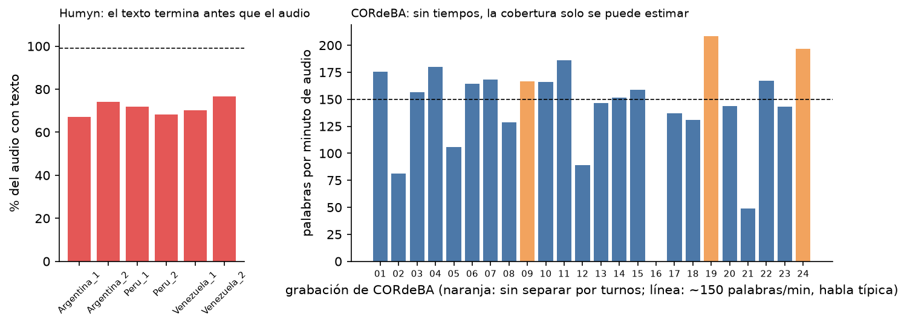

# EDA de viabilidad

**Documento 2 de 4 del [Hito 2](README.md)**

**Equipo:** Luisa, Bruno, Matías, Felipe.

**Muestra:** [`hito-2/muestra/`](muestra/) · **Notebook:** [`hito-2/notebooks/eda_viabilidad.ipynb`](notebooks/eda_viabilidad.ipynb)

**Alcance:** producto en castellano, evaluado por módulo. Los datos son el
conjunto de evaluación: no se entrena ningún modelo.

**Resultado:** 25 niveles. "Celda" es el identificador de la celda del notebook.

| Módulo | Sí | No | En parte | Pendiente |
|---|---|---|---|---|
| Transcripción (castellano) | 4 | 4 | 3 | 2 |
| Separación de hablantes | 4 | 2 | 0 | 0 |
| Minuta | 2 | 2 | 0 | 1 |
| De punta a punta | 0 | 1 | 0 | 0 |

---

## 1. Requerimientos: el nivel que el producto necesita

Fijados en [`niveles-a-priori.md`](niveles-a-priori.md), por módulo.

| Propiedad | Nivel que el producto necesita | De dónde sale |
|---|---|---|
| Volumen | **V1** ≥ 3 h y ≥ 30 hablantes en castellano. **V2** ≥ 1 h espontánea. **V3** ≥ 20 sesiones y ≥ 3 h con hablantes y tiempos. **M1** ≥ 10 reuniones con minuta completa. **V5** ≥ 10 reuniones en castellano con todo | Medir cada módulo con margen de error acotado; el umbral del canvas necesita 10 reuniones |
| Completitud | **C1** transcripción en ≥ 99% de los audios. **C2** hablante en ≥ 95% de los turnos. **C4** ≥ 80% de decisiones y acciones con evidencia. **C5** género, edad y acento en ≥ 70% de una fuente | Canvas §3 y §7 |
| Corrección | **K1** duplicados ≤ 1%. **K2** cero turnos inválidos. **K3** ≥ 99% de audios legibles. **K4** ≤ 1% de textos con caracteres ajenos | Las métricas comparan texto y tiempos |
| Vigencia | **G1** ≥ 80% de las horas desde 2015. **G2** una fuente de videollamada | El producto graba reuniones virtuales |
| Representatividad | **R1** ningún género bajo 30%. **R2** ≥ 50% de 30 años o más. **R3** ≥ 50% espontáneo. **R4** ≥ 50% de sesiones con 3 a 8 hablantes. **R5** ≥ 30 minutas en castellano. **R6**, **M2** ≥ 30% de horas de reuniones reales | Canvas §1 |
| Confiabilidad | **F1** transcripción hecha por personas. **F3** ≤ 2% de desacuerdo entre dos transcriptores. **M3** juez LLM de acuerdo con humanos en ≥ 80% (κ ≥ 0,6) | La referencia tiene que ser más confiable que lo que se mide |

## 2. Resultados de la verificación

### Transcripción (castellano rioplatense)

Fuentes: OpenSLR 61 (leído), CORdeBA (espontáneo, sin tiempos), Humyn LATAM · Argentina (espontáneo, con tiempos).

| Id | Medido o estimado | Resultado | Celda | Si es estimado, procedencia | Cumple |
|---|---|---|---|---|---|
| V1 | Medido | 15,0 h y 44 hablantes (OpenSLR 61 8,0 h; CORdeBA 6,4 h; Humyn Argentina 0,52 h) | `V1` | — | Sí |
| V2 | Medido | 58.076 palabras espontáneas (54.577 de CORdeBA, sin tiempos; 3.499 de Humyn, con tiempos) | `V2` | — | Sí |
| C1 | Medido | OpenSLR 61: 100,0%. Humyn: el texto cubre 71,4% del audio. CORdeBA: sin tiempos; 3 de 23 grabaciones bajo 100 palabras/min | `C1` | — | **En parte** |
| C5 | Medido | OpenSLR 61 solo trae género; CORdeBA y Humyn, nada | `C5` | — | **No** |
| K1 | Medido | 1,4%: 78 de 5.739 clips repiten hablante y oración | `K1` | — | **No**: se deja uno de cada par |
| K3 | Medido | OpenSLR 61: 100,0% de 5.739. CORdeBA: 23 de 24. Humyn: 100,0% | `K3` | — | **En parte** |
| K4 | Medido | 0,0% (OpenSLR 61), 0,4% (Humyn), 0,0% (CORdeBA). 26,3% de los turnos de CORdeBA trae marcas de solapamiento, que la regla quita | `K4` | — | Sí |
| G1 | Estimado | Entre 53,6% y 92,8% de las horas desde 2015 | `G1` | Fichas: OpenSLR 61 2018–2019; CORdeBA 2014–2019 | Pendiente |
| R1 | Medido | OpenSLR 61: 69,9% mujeres, 30,1% varones | `R1` | — | Sí |
| R2 | Estimado | Sin edad por hablante. CORdeBA: mediana de 24 años | `R2` | Ficha de CORdeBA | **No** |
| R3 | Medido | 46,4% de las horas son espontáneas (6,9 h de 15,0 h) | `R3` | — | **No** |
| F1 | Estimado + medido | Las tres declaran transcripción humana. 20 de 28 filas de Humyn no cumplen su ficha (ninguna de las 6 en castellano) | `F1` | Fichas | **En parte** |
| F3 | No medido | Doble transcripción de 44 clips (uno por hablante) | `F3` | — | Pendiente |

### Separación de hablantes

No depende del idioma. Fuentes: AMI, ICSI, VoxConverse (inglés) y Humyn LATAM (castellano).

| Id | Medido o estimado | Resultado | Celda | Si es estimado, procedencia | Cumple |
|---|---|---|---|---|---|
| V3 | Medido | 700 sesiones, 236 h (AMI 171, ICSI 75, VoxConverse 448, Humyn 6). Audio de AMI e ICSI disponible: 246 de 246 | `V3` | — | Sí |
| C2 | Medido | 100,0% de los turnos con hablante | `C2` | — | Sí |
| K2 | Medido | 12 turnos con fin ≤ inicio (AMI 2, Humyn 10). Tiempos contra audio en 21 extractos: AUC mediana 0,89 | `K2` | — | **No**: se descartan por regla |
| G2 | Estimado | 0 de 4 fuentes de videollamada | `G2` | Documentación de las fuentes | **No** |
| R4 | Medido | 70,4% de las sesiones con 3 a 8 hablantes. Habla superpuesta: 17,4% (AMI), 10,6% (ICSI), 3,3% (VoxConverse) | `R4` | — | Sí |
| R6 | Medido | 57,8% de las horas son de reuniones reales | `R6` | — | Sí |

### Minuta

Fuente: AMI (inglés).

| Id | Medido o estimado | Resultado | Celda | Si es estimado, procedencia | Cumple |
|---|---|---|---|---|---|
| M1 | Medido | 105 reuniones con resumen, decisiones y acciones, en 37 series (142 con alguna minuta; 2.602 ítems, sin 47 marcadores `*NA*`) | `M1` | — | Sí |
| M2 | Medido | 3,5% de las horas con minuta son de reuniones reales (2,6 h de 75,1 h) | `M2` | — | **No** |
| M3 | No medido | El equipo etiqueta una muestra de ítems y se compara contra el juez | `M3` | — | Pendiente |
| C4 | Medido | 90,5% de las 972 decisiones y acciones tienen un fragmento enlazado (22.100 enlaces, 137 reuniones) | `C4` | — | Sí |
| R5 | Medido | 0 de 142 minutas en castellano | `R5` | — | **No**: se traduce (dataset derivado) |

### De punta a punta

| Id | Medido o estimado | Resultado | Celda | Si es estimado, procedencia | Cumple |
|---|---|---|---|---|---|
| V5 | Medido | 0 reuniones en castellano con audio, transcripción, hablantes y minuta | `V5` | — | **No**: reuniones propias |

## 3. Exposición al *leakage*

No hay entrenamiento. Se busca lo que inflaría la evaluación.

| Búsqueda | Qué se busca | Resultado | Celda |
|---|---|---|---|
| La definición | Columnas posteriores al momento de predecir | 65 de 151 columnas son anotación posterior; 13 apuntan al audio. La minuta se evalúa sobre la salida del transcriptor, no sobre la transcripción manual | `L1` |
| El tiempo | Si el modelo ya vio los datos | pyannote entrenó o ajustó con **154 de 171** reuniones de AMI; quedan **91 no vistas** (16 AMI + 75 ICSI). Las minutas de AMI son públicas hace más de 15 años. Whisper no publica sus datos | `L2` |
| Los duplicados | Exactos y casi exactos | OpenSLR 61: 82,8% de los clips lee una oración que lee otro hablante. AMI: 18,7% de las decisiones y acciones tiene un ítem casi idéntico en otra serie | `L3` |
| Los grupos | Varias filas de una misma persona | OpenSLR 61: 44 hablantes para 5.739 clips. AMI: las 142 minutas son 37 series con las mismas personas. ICSI: un hablante está en 49 de 75 reuniones | `L4` |
| La generación | Cómo se produjo cada dato | OpenSLR 61: 100% lectura. AMI: 72,5% de las horas y 97,2% de las minutas son de reuniones actuadas. ICSI: 5,2% del habla es lectura de dígitos | `L5` |

**Consecuencias:** se parte por hablante (OpenSLR 61) y por serie (AMI); la
separación de hablantes se evalúa sobre las 91 reuniones no vistas; los
resultados de minuta sobre AMI se leen como techo.
