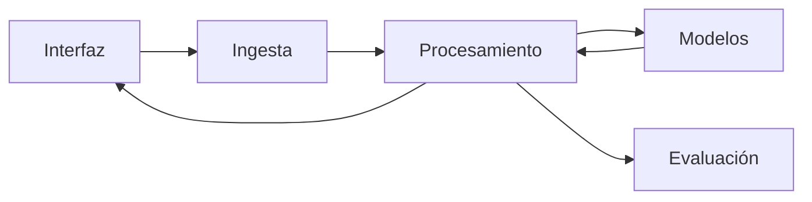

# Definición de la PoC - Generación automática de minutas

**Documento del Hito 3 · Luisa, Bruno, Matías y Felipe · se entrega con el tag `hito-3`**

Insumos: [`canvas.md`](../canvas.md) (Hito 1) y [`4-veredicto.md`](../hito-2/4-veredicto.md) (Hito 2).

## Historial de versiones

| Versión | Fecha | Qué cambió |
|---|---|---|
| 1, Hito 3 | 2026-11-01 | Primera versión completa |
| 2, Hito 3 | 2026-11-03 | Etapa de asociación y etiquetado de hablantes: el usuario nombra a cada hablante antes de generar la minuta (2.1, 2.2, 2.3, 3.1.3, 3.1.4, 3.2 y 4.1) |
| 3, Hito 4 | 2026-11-16 | Admisión de reuniones externas con autorización de uso documentada para la evaluación integral (1.1, 2.1, 2.3, 3.1.2 y 3.1.5), sin modificar los umbrales ni los ensayos de captura y recuperación |
| 4, alcance congelado | 2026-11-19 | Triage del backlog después del checkpoint: lo que no entra se suma a 1.3 con la pregunta que lo decidió, y la nueva sección 5 fija la definición de terminado, lo que entra y el compromiso público. Los criterios y umbrales de 2.3 no cambian |

---

## 1. Propuesta

### 1.1 Overview

La PoC es una aplicación de ejecución local que captura el audio del micrófono y del sistema, identifica hablantes, transcribe las intervenciones y genera minutas con temas y acciones. Está orientada a organizaciones con terminología especializada e información confidencial. Sus módulos se comprueban con datos reales del Hito 2: OpenSLR, CORdeBA, Humyn y Common Voice para transcripción; Figshare (UBA Games) y CALLHOME para diarización, y AMI para minutas, con traducciones sintéticas al castellano. El veredicto del Hito 2 ajustó el alcance porque el EDA registró V5 = 0/10 reuniones con referencias integrales en castellano: se comprueba cada módulo y se demuestra el workflow completo con grabaciones propias o externas autorizadas, sin dar por validada su calidad integral. Quedan afuera el entrenamiento, la optimización, la comparación de modelos y la personalización terminológica.

### 1.2 Objetivo

1. **Supuesto y riesgo.** De **factibilidad**: es viable integrar captura, diarización, transcripción y generación de minutas en una aplicación local, con modelos preentrenados y el hardware disponible. Valor, usabilidad y viabilidad no se prueban: la PoC no sale a usuarios externos al equipo.
2. **Qué lo valida.** Los criterios de 2.3: una reunión real en castellano procesada de la grabación a la minuta, con cada módulo entregando una salida que el siguiente puede usar.
3. **Qué decisión habilita.** **GO** si se cumplen todos los criterios de 2.3: se congela el alcance en la semana 10 y se sigue con el producto. **Ajustar** si falla alguno, pero la minuta de la reunión de prueba recupera al menos 1 tema y 1 acción sin inventar ninguna: se corrige el módulo responsable y se vuelve a medir. **NO GO** si, agotados los planes B de 1.4, la minuta no recupera ninguna acción o inventa alguna: se abandona el enfoque local con modelos preentrenados.

### 1.3 Fuera de alcance

1. **Personalización terminológica:** el funcionamiento general se demuestra con modelos preentrenados, sin adaptarlos al vocabulario de cada organización.
2. **Evaluación sistemática de minutas** (LLM-as-a-Judge, embeddings): la revisión manual contra notas de referencia alcanza para la reunión de prueba.
3. **Optimización del rendimiento y pruebas de carga:** la PoC demuestra el workflow; la latencia solo se registra (2.3).
4. **Hardware de bajos recursos:** la PoC corre en las máquinas de Matías y Bruno, de iguales prestaciones, sin variantes para equipos con menos capacidad.
5. **Comparación de modelos:** se elige una herramienta por módulo según compatibilidad, integración y memoria (3.1.1); comparar alternativas no cambia lo que la PoC demuestra.

Sumados en el triage del alcance congelado (sección 5), con la pregunta que los dejó afuera:

6. **Fidelidad semántica de minutas extensas (#17):** casos nuevos y medición de omisiones y contradicciones entre bloques. Pregunta 1: no cambia lo que ve el jurado, que ve una reunión de 5 minutos; 2.1.5 ya tiene evidencia.
7. **Transcripción y diarización en un servidor:** llevar Whisper y pyannote a otra máquina, con el audio por la red. Preguntas 2 y 3: toca el pipeline y compite con el plan B de calidad.
8. **Validación multiplataforma completa (#18):** instalaciones desde cero en Linux y Windows, CPU y GPU, con verificación automatizada. Pregunta 2: es casi una semana de trabajo; entra solo la matriz de lo ya verificado.

### 1.4 Riesgos

1. **La memoria de la GPU no alcanza.** Sale de la decisión 3.1.1: las máquinas de Matías y Bruno, iguales, tienen una RTX 3050 Laptop con 6 GB de VRAM y 31 GB de RAM; Whisper `medium` requiere unos 5 GB y `qwen2.5:7b` cuantizado 4,7 GB: no entran juntos. Plan B: etapas en secuencia liberando memoria; si una sola no entra, Whisper `small` (unos 2 GB), `qwen2.5:3b` (1,9 GB) o CPU, registrando el cambio y su latencia.
2. **Errores acumulados entre módulos.** Sale del veredicto: V5 = 0/10, sin evidencia previa de la calidad conjunta. Señal: la minuta no cumple la fila de calidad de 2.3. Plan B: generar la minuta desde la transcripción corregida a mano; si así cumple, se cambia el modelo de diarización o de ASR; si no, se ajusta el prompt.
3. **Referencias de diarización no puntuables.** Sale del veredicto: en CALLHOME, 2/15 audios tienen anotaciones que exceden su duración (159/3.168 segmentos), y F3 y M3 siguen sin medir. Plan B: excluir con trazabilidad esos segmentos, como indica el plan del veredicto; si la muestra queda sin sentido, medir la diarización solo sobre las nueve sesiones de Figshare.

---

## 2. Spec

### 2.1 Escenarios

#### Happy path

- **Dado:** una reunión propia de prueba (o una reproducción autorizada de la fuente externa de 2.3) y sus notas de referencia, escritas antes de procesar; el usuario eligió el micrófono, el audio del sistema y el directorio de salida.
- **Cuando:** inicia la grabación al empezar la reunión y la detiene al terminar.
- **Entonces:** la aplicación guarda la grabación en el directorio elegido.
- **Y:** el usuario pide procesarla y ve el avance de cada etapa.
- **Y:** al terminar la diarización y la transcripción, ve una ficha por hablante con un fragmento de su audio y el texto correspondiente, lo escucha y escribe su nombre (2.2, punto 5).
- **Y:** quedan la transcripción, con el nombre del hablante y la marca temporal de cada intervención, y la minuta, con temas, decisiones y acciones con responsable por su nombre, cada una con su marca temporal.
- **Y:** la minuta recupera los 2 temas y la acción de las notas, sin acciones que no estén en la grabación.
- **Y:** la misma reunión, cargada como varios archivos en orden, produce una sola transcripción y una sola minuta.

#### Casos borde

##### 2.1.1 Terminología especializada

- **Dado:** la reunión incluye terminología especializada y anglicismos.
- **Cuando:** el ASR transcribe las intervenciones.
- **Entonces:** transcribe sin adaptación terminológica y conserva el audio.
- **Le cuesta al usuario:** encontrar y corregir a mano los términos mal transcritos.

##### 2.1.2 Voces similares y habla superpuesta

- **Dado:** participan personas con voces similares y hay intervenciones superpuestas.
- **Cuando:** se ejecuta la diarización.
- **Entonces:** conserva etiquetas, intervalos y solapamientos, y marca las intervenciones de hablante ambiguo.
- **Y:** si separa a una persona en dos etiquetas, el usuario les pone el mismo nombre al etiquetar y se tratan como una sola.
- **Le cuesta al usuario:** revisar confusiones al atribuir decisiones y responsables.

##### 2.1.3 Seis o más hablantes

- **Dado:** una reunión con 6 o más hablantes, como 57 de las 75 de ICSI del Hito 2.
- **Cuando:** se ejecuta la diarización.
- **Entonces:** etiqueta a cada hablante detectado y marca como ambiguas las intervenciones que no puede atribuir; si no termina, lo informa y conserva el audio.
- **Le cuesta al usuario:** revisar más atribuciones dudosas y nombrar más hablantes.

##### 2.1.4 Ruido o interferencias

- **Dado:** la grabación tiene ruido ambiental o interferencias del micrófono.
- **Cuando:** el sistema la procesa.
- **Entonces:** conserva el audio y los resultados, sin garantizarlos, e informa si alguna etapa falla.
- **Le cuesta al usuario:** perder lo que no se entiende y completar la minuta con notas o consultas. Es el peor caso borde.

##### 2.1.5 Transcripción más larga que el contexto del LLM

- **Dado:** la transcripción supera la capacidad de entrada del LLM.
- **Cuando:** se genera la minuta.
- **Entonces:** la procesa por fragmentos y consolida; si no puede, lo informa y conserva la transcripción.
- **Le cuesta al usuario:** quedarse sin minuta completa y volver a procesar.

#### Error del sistema

- **Dado:** el usuario está grabando y la aplicación escribe el audio en disco mientras graba.
- **Cuando:** la aplicación se cierra inesperadamente.
- **Entonces:** queda en el directorio un archivo procesable con lo grabado hasta el corte, salvo como máximo los últimos 5 segundos, marcado como interrumpido.
- **Y:** al reiniciar, la aplicación lista la grabación interrumpida y ofrece procesarla. Se pierde lo dicho hasta la nueva grabación.

### 2.2 User experience

1. **Interacción y control.** El usuario elige dispositivos y directorio, graba, y procesa uno o varios archivos; si son varios, fija su orden y se tratan como una reunión. Ve el estado de cada etapa y abre el directorio de resultados.
2. **Señal de confianza.** No se muestra un puntaje del modelo, sino evidencia verificable: la transcripción marca los tramos con habla superpuesta y las intervenciones de hablante ambiguo (las que caen sobre más de un turno o sobre ninguno), y en la minuta cada decisión y acción cita la marca temporal que la respalda, para comprobarla en el audio.
3. **Corrección o aviso.** El usuario corrige la minuta fuera de la aplicación, en un formato editable, y puede volver a procesar. Dentro de la aplicación solo se editan los nombres de los hablantes (punto 5); no se editan transcripciones ni turnos.
4. **Peor caso borde (2.1.4).** Con ruido intenso, el sistema conserva el audio e informa la etapa que falló; si hay resultados, el usuario los revisa con las marcas del punto 2 y completa lo que no se entiende con notas o consultas.
5. **Etiquetado de hablantes.** Al terminar la diarización y la transcripción, el procesamiento se detiene y muestra una ficha por hablante detectado, ordenadas por tiempo de habla: su etiqueta (por ejemplo, `SPEAKER_00`), un fragmento de 5 a 15 s en que habla solo, con botón para reproducirlo, el texto de ese fragmento y un campo para el nombre. El usuario puede pedir otro fragmento si no reconoce la voz. Un nombre vacío deja la etiqueta, y dos etiquetas con el mismo nombre se tratan como una persona. Al confirmar, la transcripción y la minuta usan los nombres y el procesamiento sigue. Por línea de comandos, sin interfaz, el paso se saltea y quedan las etiquetas.

### 2.3 Criterios de aceptación

| Criterio | Métrica | Umbral | Conjunto de evaluación | Cómo se chequea |
|---|---|---|---|---|
| Calidad de la respuesta | Temas y acciones de las notas de referencia que la minuta recupera (nombrados aunque sea con otras palabras; las acciones, con su responsable) y acciones inventadas (sin respaldo en la marca temporal que citan ni en las notas) | 2/2 temas y 1/1 acción recuperados, y 0 inventadas, en las 2 modalidades (un archivo y varios ordenados) | Reunión de prueba: real, propia y consentida o externa con autorización de uso documentada, en castellano, de al menos 5 minutos, con 2 temas y 1 acción explícita; completa y dividida en 2 o más archivos | Un integrante que no ejecuta el procesamiento escribe antes las notas (temas, acciones, responsables y marcas temporales) y marca sí o no por ítem |
| Funcionamiento modular | Salidas dentro del contrato del módulo siguiente. Diarización: segmentos con hablante, inicio menor que fin y dentro del audio. Transcripción: segmentos con texto y tiempos. Asociación: intervenciones con etiqueta de hablante, nombre o vacío, texto, tiempos y marcas de solapamiento y ambigüedad. Minuta: secciones de temas, decisiones y acciones | 4/4 módulos con el 100 % de sus salidas dentro del contrato | Muestra congelada en la semana 7, con su SHA-256 en un manifiesto: 5 clips de OpenSLR y Common Voice, 3 sesiones de Figshare y 3 reuniones de AMI traducidas | Script de contratos |
| Latencia (máximo, p100) | Tiempo desde que se pide procesar hasta que la minuta queda escrita, sin contar el que el usuario tarda en nombrar a los hablantes | Las 5 corridas en 30 minutos o menos para 5 minutos de audio | La reunión de prueba, 5 corridas en la máquina de Matías (RTX 3050 Laptop, 6 GB de VRAM, 31 GB de RAM) | Tiempo registrado en cada corrida |
| Cobertura de los casos borde | Escenarios de 2.1 que hacen lo que dice su «Entonces», con la entrada conservada | 7/7: happy path, 2.1.1 a 2.1.5 y error del sistema | Un input real o preparado por escenario, fijado antes de la semana 9 (2.1.3: una reunión de ICSI con 6 o más hablantes) | Un tercero recorre los escenarios con la aplicación abierta y marca sí o no |
| Recuperación ante interrupciones | Tiempo grabado hasta un corte forzado menos la duración del archivo que queda | 1/1 prueba con 5 s perdidos o menos, el archivo procesable y listado como interrumpido al reiniciar | Una grabación propia de al menos 2 minutos, cortada cerrando el proceso a la fuerza | Comparar las duraciones, reiniciar la aplicación y procesar el archivo |
| Ventaja sobre el *baseline* | No aplica: lo construido es el *baseline* (3.1.1) | — | — | — |

Se registran versiones, orden de los archivos, notas y resultados. WER, DER y JER no tienen umbral: sin un *baseline* con que comparar, sería arbitrario.

---

## 3. Diseño

### 3.1 Decisiones de diseño

#### 3.1.1 El modelo

**Contexto.** Identificar hablantes, transcribir en castellano y generar minutas con modelos preentrenados, en local y con 6 GB de VRAM.

**Alternativas evaluadas.**

1. **Locales: pyannote, Whisper y Qwen2.5 con Ollama.** Intervalos por hablante, transcripción en castellano con marcas temporales y texto estructurado, sin sacar datos de la máquina. Riesgo: la memoria. Sigue en pie.
2. **Locales configurables: NVIDIA NeMo y Kaldi.** Flexibles, pero exigen más configuración e integración. Descartadas: no entran en tres semanas.
3. **APIs: ElevenLabs Scribe, AWS Bedrock y Groq Cloud.** Sin límite de memoria local, pero sacan audio y transcripciones de la máquina y agregan cuotas y costos. Descartadas por confidencialidad.

**Decisión.** La 1: pyannote `speaker-diarization-community-1`, Whisper `medium` y `qwen2.5:7b`, que es a la vez el *baseline*: lo más simple que podría funcionar ya incluye diarización, porque sin hablantes la minuta no puede asignar responsables. Inclinó la memoria: Whisper `medium` (unos 5 GB) es el multilingüe más grande que entra (`large` pide unos 10 GB y `turbo` unos 6 GB, toda la GPU), y `qwen2.5:7b` cuantizado (4,7 GB) es el Qwen2.5 más grande que entra y admite castellano. `community-1` es el pipeline abierto de pyannote y pide aceptar sus condiciones en Hugging Face. **No sabemos** cuánto rinden los tres en castellano rioplatense: se prueban en la semana 7 con la muestra de 2.3.

**Consecuencias.** Se asume correr por etapas (riesgo 1) y que los errores pueden acumularse (riesgo 2). Se resignan modelos más grandes y APIs.

> **Actualización posterior (13/11/2026; integración de la PoC, sin modificar el tag de Hito 3).**
> La exclusión histórica de APIs remotas se mantiene aquí como decisión documentada
> en la definición original. Para la implementación experimental se acordó habilitar
> modelos de minutas de Ollama y Bedrock. **Todos** se emplean como sustitutos
> experimentales y no como modelos definitivos del producto. Bedrock permite ensayar
> modelos cuyo requerimiento de cómputo excede el hardware disponible. No se evalúa
> equivalencia de calidad, velocidad o requisitos locales de esa sustitución; la
> motivación de confidencialidad del producto no cambia. Cada transferencia de
> transcripción a un destino externo requiere consentimiento explícito y se realiza
> únicamente con datos apropiados para esta PoC. La evaluación debe registrar qué
> modelo y modalidad se usaron, sin atribuir al hardware local las latencias remotas.

#### 3.1.2 Los datos

**Contexto.** El Hito 2 dejó datos para evaluar módulos, pero ninguna reunión integral en castellano (V5 = 0/10).

**Alternativas evaluadas.**

1. **Solo los conjuntos del Hito 2:** tienen referencias, pero no demuestran el workflow en castellano. Descartada.
2. **Solo grabaciones propias:** representan el uso, pero sin referencias por módulo. Descartada.
3. **Combinar ambas:** comprueba módulos e integración sin un corpus nuevo. Sigue en pie.

**Decisión.** La 3. Del plan del veredicto se mantienen la obtención con originales, permisos y hashes, la exclusión trazable de tramos inválidos, la distinción de las traducciones sintéticas y los conjuntos separados por módulo, de los que se congela la muestra de 2.3. Cambia la evaluación integral: una reunión de prueba con notas de referencia en lugar de diez reuniones anotadas, porque la PoC demuestra el funcionamiento integral y no lo valida. Varios archivos ordenados forman una reunión. La evaluación integral admite una grabación externa real con autorización documentada y un fragmento continuo delimitado antes de las corridas; se registran procedencia, licencia, intervalo y hashes. Los ensayos de captura y recuperación conservan la grabación efectiva desde la aplicación.

**Consecuencias.** Se conservan los originales, su orden y la correspondencia temporal con el audio procesado. Se resigna validar la calidad integral hasta reunir las diez reuniones anotadas.

#### 3.1.3 Workflow o agente

**Contexto.** Las etapas son conocidas: preparar el audio, diarizar, transcribir, asociar los resultados y generar la minuta.

**Alternativas evaluadas.**

1. **Agente** que decide qué herramientas usar: agrega decisiones y puntos de falla que este recorrido fijo no necesita. Descartada.
2. **Workflow fijo:** controla las etapas, verifica sus contratos y localiza los errores. Sigue en pie.

**Decisión.** La 2, posterior a la grabación: la diarización y el ASR procesan por separado el mismo audio normalizado, sus resultados se asocian por marcas temporales, el usuario nombra a cada hablante (2.2, punto 5) y la transcripción estructurada alimenta al LLM, por fragmentos si excede su contexto.

**Consecuencias.** Recorrido reproducible, con resultados parciales conservados; las atribuciones ambiguas no se presentan como seguras. El recorrido se detiene una vez, para el etiquetado. Se resigna la flexibilidad de un agente.

#### 3.1.4 Construir o usar hecho

**Contexto.** Hay un grabador en Python (sounddevice) para micrófono y audio del sistema, modelos preentrenados y tres semanas.

**Alternativas evaluadas.**

1. **Solución integral (WhisperX, que integra Whisper con la diarización de pyannote):** ahorra integración, pero deja dentro de la herramienta la asociación entre turnos y texto, que la PoC tiene que controlar y evaluar por módulo. Descartada.
2. **Integrar componentes existentes:** exige adaptadores y orquestación, pero reutiliza el grabador, los modelos y el trabajo del Hito 2. Sigue en pie.

**Decisión.** La 2, porque conserva el control de cada módulo. Hechos: grabador, FFmpeg, pyannote, Whisper y Ollama. Construidos: escritura incremental del audio, preparación de entradas, asociación de resultados, etiquetado de hablantes, orquestación e interfaz, con el procesamiento independiente de la GUI.

**Consecuencias.** Se asume mantener las integraciones; se resigna la integración ya resuelta de WhisperX.

#### 3.1.5 Requerimientos no funcionales

**Contexto.** Reuniones potencialmente confidenciales, fallos que hay que poder revisar y hardware fijo.

**Alternativas evaluadas.**

1. **Rendimiento y hardware variado:** exige optimización y pruebas de carga fuera de alcance. Descartada.
2. **Ejecución local y trazabilidad:** permite diagnosticar errores. Sigue en pie.

**Decisión.** La 2. **Confiable:** 5 s perdidos o menos ante un corte, resultados intermedios conservados y versiones y configuración registradas en cada corrida. **Escalable:** una reunión a la vez y una persona por máquina, sin exigir más. **Mantenible:** cada módulo se ejecuta por separado y se valida contra su contrato de 2.3. Por confidencialidad, las pruebas usan reuniones propias consentidas o externas autorizadas, sin información sensible, y todo queda en el directorio local elegido.

**Consecuencias.** No se garantiza escalabilidad ni rendimiento en hardware de bajos recursos; la recuperación se limita a lo que llegó a escribirse.

### 3.2 Arquitectura

Workflow fijo, sin agente.

| Pieza | Qué es en este proyecto | Se construye o se usa hecha | Con qué |
|---|---|---|---|
| Ingesta | Grabación con escritura incremental o carga ordenada de archivos | Se reutiliza y amplía | sounddevice y soundfile (grabación); FFmpeg (archivos cargados) |
| Procesamiento | Normalización y unión de audio, asociación temporal de hablantes y texto | Se construye, con lo pertinente del Hito 2 | FFmpeg y Python |
| Modelo o agente | Diarización, transcripción y generación de minutas | Se usan modelos preentrenados | pyannote `speaker-diarization-community-1`, Whisper `medium` y `qwen2.5:7b` mediante Ollama |
| Interfaz | Grabar, cargar, procesar, nombrar a los hablantes y revisar resultados | Se amplía la GUI existente | PySide6 (Qt); sounddevice para reproducir los fragmentos |
| Evaluación | Comprobación modular e integral contra 2.3 | Se reutiliza y amplía | Scripts del Hito 2, manifiesto SHA-256 y script de contratos |

---

## 4. Plan

### 4.1 Plan de construcción

| Semana | Meta | Qué se construye | Quién | Qué se muestra al cierre |
|---|---|---|---|---|
| 7, Workshop 1 | Datos listos | Muestra congelada con SHA-256; reunión de prueba y sus notas; escritura incremental; preparación y unión de audio; prueba de los tres modelos | Matías y Felipe | Manifiesto, reunión de prueba con notas y cada módulo corriendo por separado |
| 8, Workshop 2 | *Baseline* de punta a punta | Asociación temporal con marcas de solapamiento y ambigüedad, y etiquetado de hablantes (Matías); minuta con marcas temporales, orquestación, recuperación e interfaz (Bruno) | Matías y Bruno | El happy path con la reunión de prueba, en un archivo y en varios |
| 9, Workshop 3 | Evaluación y cierre | Criterios de 2.3, casos borde y recuperación | Luisa | La tabla de 2.3 con sí o no por fila y la decisión |

---

## 5. Alcance congelado

Fijado el 19/11/2026, después del checkpoint del Hito 4 ([estado contra 2.3](../hito-4/estado-checkpoint.md)), con la decisión provisional **Ajustar**. De acá al Demo Day (1/12) no se agregan capacidades.

### 5.1 Definición de terminado

| | Terminado cuando |
|---|---|
| La demo corre este flujo | Desde la interfaz, la reunión de prueba (OSM LatAm, 339 s) se carga, se procesa viendo el avance de cada etapa, se nombra a los hablantes en las fichas, se revisan la transcripción y la minuta, y la minuta se copia al portapapeles. Una grabación corta desde la interfaz queda en el directorio elegido |
| La evaluación reporta estas métricas | Los 5 criterios de 2.3, cada uno como sí, parcial o no con su número, sobre la versión final. La calidad, en las 2 modalidades y con las mismas notas de referencia, para el *baseline* y para la variante del plan B del riesgo 2. Por módulo, sobre la muestra congelada: WER y CER, DER y JER, palabras con el hablante correcto e ítems de AMI recuperados; y el WER por dataset y por país (#27) |
| El repo se instala con estos pasos | Los del [README](../README.md): perfil `cu128` en Linux con GPU, verificado desde cero (#18), y `python -m src.verificar_entorno` sin fallas; la matriz del #18 declara lo verificado en Windows y sus límites |

### 5.2 Lo que entra

Cada ítem pasó las tres preguntas del triage: cambia lo que ve o mide el jurado, su esfuerzo con la evaluación incluida y su riesgo de regresión. «~» marca lo que entra solo si sobra tiempo. Responsables y fechas, según el plan de cierre del checkpoint.

| Ítem | Esfuerzo | Riesgo | Responsable | Fecha |
|---|---|---|---|---|
| Plan B del riesgo 2: minuta desde la transcripción corregida a mano (diagnóstico, sin ajustar nada) y, según el resultado, cambio de modelo o ajuste del prompt con casos de desarrollo distintos de la reunión de prueba, que queda solo para medir | Medio | Bajo: se evalúa como variante, sin reemplazar el *baseline* | Felipe (transcripción), Bruno (minuta), responsable de cada módulo | 21/11 y 22/11 |
| Volver a medir la calidad en las 2 modalidades, para el *baseline* y la variante sobre los mismos casos y contra los mismos umbrales | Bajo | Ninguno | Matías (corridas), Bruno (evaluación) | 22/11 |
| Recorrido del tercero con el protocolo de escenarios | Bajo | Ninguno | Luisa | 20/11 |
| Botón «Copiar» en los visores de minuta y transcripción (#28) | Bajo | Bajo: solo el diálogo del visor | Matías | 19/11 |
| Modelo de minutas en un servidor de la red: prueba entre dos máquinas, latencia medida y README | Bajo: sin cambios de código | Ninguno | Matías y Bruno | 24/11 |
| Evaluación de STT por dataset y país (#27) | Hecho; falta integrarlo | Ninguno | Felipe | 20/11 |
| Matriz de plataformas verificadas y cierre del #18 | Bajo | Ninguno | Luisa | 22/11 |
| ~ Campo para la dirección del servidor de Ollama en la interfaz | Bajo | Medio: toca la validación del destino y la autorización | Matías | Solo si sobra tiempo |

#### Escenario agregado: modelo de minutas en un servidor de la red

No suma a la cobertura de casos borde de 2.3, que sigue en 7/7.

- **Dado:** el modelo de minutas está en un Ollama de otra PC de la red, configurado con `OLLAMA_HOST`.
- **Cuando:** el usuario pide generar la minuta.
- **Entonces:** la aplicación lo informa como servicio externo y pide autorización; sin ella, no envía nada.
- **Y:** con autorización, envía la transcripción, los nombres y las marcas temporales, nunca el audio, y la minuta registra el destino.

### 5.3 Compromiso público

> «En el Demo Day vamos a mostrar exactamente esto: una reunión real en castellano que pasa por la aplicación de punta a punta en una laptop con 6 GB de GPU (cargar, nombrar a los hablantes, ver la transcripción y la minuta con sus marcas temporales, y copiarla), y los cinco criterios de 2.3 medidos tal cual, con la calidad antes y después del ajuste.»
