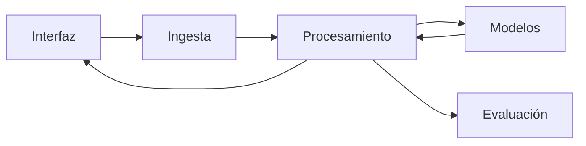

# Definición de la PoC - Generación automática de minutas

**Documento del [Hito 3](README.md) · en equipo · se entrega en el repo del equipo como `definicion-de-la-poc.md`, con el tag `hito-3`**

El documento tiene cuatro partes, que siguen las de un cambio en OpenSpec: la propuesta (por qué y hasta dónde; `proposal.md`), la spec (cómo se comporta el sistema y cuándo está terminado; `specs/`), el diseño (las decisiones de diseño y la arquitectura; `design.md`) y el plan (las tres semanas de construcción; `tasks.md`). Los datos y el plan del pipeline vienen del Hito 2; el código se escribe en el Módulo 4.

| # | Parte | Secciones | Cuándo se completan |
|---|---|---|---|
| 1 | Propuesta | 1.1 Overview; 1.2 Objetivo; 1.3 Fuera de alcance; 1.4 Riesgos | 1.1 y 1.2 en la Clase 5; 1.3 y 1.4 en la Clase 6 |
| 2 | Spec | 2.1 Escenarios; 2.2 User experience; 2.3 Criterios de aceptación | Clase 6 |
| 3 | Diseño | 3.1 Decisiones de diseño, un registro por decisión; 3.2 Arquitectura | El registro del modelo en la Clase 5; los demás y 3.2 en la Clase 6 |
| 4 | Plan | 4.1 Plan de construcción | Clase 6 |

**Extensión.** No más de 3.000 palabras.

**Agente de código.** Pueden usar cualquier agente disponible. En la materia recomendamos OpenSpec, que parte el documento en esos cuatro archivos, pero también pueden hacerlo completamente manual, en este archivo.

**Incógnitas.** Lo que el equipo no sepa o no pueda responder se escribe como **No sabemos**. Dejar una sección o una celda en blanco no distingue lo que no se sabe de lo que no se analizó.

## Historial de versiones

| Versión | Fecha | Qué cambió |
|---|---|---|
| 1, Hito 3 | 2026-11-01 | Definición del alcance, criterios de aceptación, decisiones de diseño, arquitectura y plan de construcción. |

Si el documento vive en varios archivos, indicar acá dónde está cada parte.

---

## 1. Propuesta

### 1.1 Overview

Describe qué hace la PoC, para quién, y con qué datos cuenta para construirse (el veredicto del Hito 2, y si los datos son reales, sintéticos o los dos). La descripción va en un párrafo, y dice qué entra en este alcance y qué del producto queda afuera por ahora. Remite a los fundamentos del veredicto del Hito 2 con la cifra del EDA que sostiene ese alcance, sin reescribirlos; si el veredicto fue ajustar, dice el alcance nuevo.

**En nuestro caso:**

La PoC consiste en una aplicación de ejecución local que captura el audio del micrófono y del sistema, identifica hablantes, transcribe las intervenciones y genera minutas con temas relevantes y acciones concretas. Está orientada a organizaciones que manejan terminología especializada e información confidencial. Para comprobar el funcionamiento de sus módulos se utilizarán datos reales relevados en el Hito 2: OpenSLR, CORdeBA, Humyn y Common Voice para transcripción; UBA Games Figshare y, complementariamente, CALLHOME para diarización; y AMI para minutas, con traducciones derivadas al castellano. El veredicto del Hito 2 ajustó el alcance porque el EDA registró V5 = 0/10 reuniones con referencias integrales en castellano. Por ello, se comprobará el funcionamiento de cada módulo y se demostrará el workflow completo con grabaciones propias, sin considerar validada todavía su calidad integral. La PoC no contempla entrenamiento, optimización de hiperparámetros, comparación de modelos ni personalización terminológica.

### 1.2 Objetivo

La PoC es un recorte arbitrario del producto con el objetivo de validar algún supuesto real del problema. Es una instancia de decisión (GO / NO GO). En esta sección detallar:

1. Qué supuesto(s) del producto pone a prueba la PoC y qué riesgos mitiga (revisar Módulo 1).
2. Qué resultado efectivamente valida el supuesto.
3. Qué decisión habilita el resultado: seguir con el producto, cambiar el enfoque o parar.

**En nuestro caso:**

1. **Supuesto:** es técnicamente viable integrar la captura de audio, la diarización, la transcripción y la generación de minutas en una aplicación ejecutada localmente, utilizando herramientas preentrenadas y el hardware disponible.

2. **Resultado que lo valida:** procesar de punta a punta una reunión real en castellano, desde su grabación hasta la generación de una minuta que refleje los temas y acciones discutidos. Comprobar que cada módulo produzca una salida utilizable por el siguiente y revisar manualmente los errores de contenido. Los criterios verificables se establecen en 2.3.

3. **Decisión:** se establece **GO** si el workflow completo cumple los criterios de aceptación; **ajustar** si existen problemas corregibles en alguno de los módulos; **NO GO** si no se consigue una minuta utilizable y los problemas impiden sostener el enfoque elegido.

### 1.3 Fuera de alcance

Lista lo que la PoC no construye, para que el recorte se decida ahora y no de apuro durante la construcción. Va un ítem por cada cosa, con su motivo, y al menos uno; entra lo que se resigna en las consecuencias de cada registro de decisión (3.1). Si cuesta llenarla, la pregunta que la destraba es cuál de las cosas que quieren hacer sacarían primero si perdieran una semana. El motivo está bien cuando dice por qué la PoC puede demostrar lo suyo sin esa pieza.

**En nuestro caso:**

1. **Personalización terminológica:** no se implementarán mecanismos para adaptar los modelos al vocabulario de cada organización. La PoC utilizará modelos preentrenados para comprobar el funcionamiento general.

2. **Evaluación exhaustiva de minutas:** no se implementarán rúbricas automatizadas ni evaluaciones sistemáticas mediante LLM-as-a-Judge o embeddings. Se realizará una revisión manual básica para comprobar que la minuta representa lo discutido.

3. **Optimización del rendimiento:** no se optimizarán los tiempos de inferencia ni se realizarán pruebas de carga. El objetivo es demostrar el funcionamiento del workflow, aunque se podrá registrar su tiempo de ejecución.

4. **Adaptación a hardware de bajos recursos:** la PoC se ejecutará sobre el hardware disponible del equipo, sin desarrollar variantes optimizadas para dispositivos con menores capacidades.

5. **Comparación de modelos:** no se implementarán distintas alternativas para compararlas experimentalmente. Las herramientas se seleccionarán según criterios técnicos y prácticos, como compatibilidad, facilidad de integración y recursos disponibles.

### 1.4 Riesgos

Anticipa lo que puede impedir que la PoC funcione y deja decidido qué hacer si ocurre. Van los 2 o 3 más probables, entre los riesgos estimados del veredicto del Hito 2 que sigan abiertos y lo que se asume en las consecuencias de cada registro de decisión (3.1). Por cada riesgo, en un párrafo: cuál es, de dónde sale (el veredicto o la decisión técnica), la cifra del veredicto o el motivo por el que es probable, y el plan B, que tiene que ser algo que el equipo pueda ejecutar.

**En nuestro caso:**

1. **Limitaciones técnicas:** los recursos de hardware, la captura simultánea de audio o la ventana de contexto del LLM podrían impedir procesar reuniones completas. Se contempla utilizar grabaciones WAV existentes, modelos menos exigentes o procesamiento por fragmentos, según el problema detectado.

2. **Confidencialidad:** el almacenamiento de grabaciones, transcripciones y minutas podría exponer información sensible. La PoC utilizará reuniones consentidas sin información sensible para las pruebas y procesará los datos localmente, conservándolos en el directorio seleccionado.

3. **Errores acumulados:** el Hito 2 registró V5 = 0/10 reuniones con referencias integrales en castellano, por lo que no se dispone de evidencia previa de la calidad conjunta de los módulos. Se revisarán las salidas intermedias para identificar fallos y ajustar los componentes responsables.

---

## 2. Spec

### 2.1 Escenarios

Cuenta qué hace el sistema en el *happy path*, en 3 a 5 casos borde y cuando se equivoca. Cada escenario se escribe como en OpenSpec: un **Dado** (el estado de partida), un **Cuando** (lo que pasa) y un **Entonces** (lo que el sistema hace), con un **Y** por cada paso que sigue. La prueba es que un tercero pueda decir, con el escenario a la vista, si el sistema hizo lo que dice.

#### Happy path

El recorrido de un input típico de punta a punta sin que nada falle. Es un solo escenario, con tantos «Y» como pasos tenga.

- Dado
- Cuando
- Entonces
- Y

**En nuestro caso:**

- **Dado:** el usuario abrió la aplicación, seleccionó los dispositivos de audio y configuró el directorio de salida.
- **Cuando:** inicia la grabación, participa de la reunión y la detiene al finalizar.
- **Entonces:** la aplicación guarda el audio registrado.
- **Y:** el usuario solicita procesar la reunión.
- **Y:** se ejecutan la diarización, la transcripción y la generación de la minuta.
- **Y:** la minuta queda disponible en el directorio seleccionado.


#### Casos borde

Un escenario por caso, numerado (2.1.1, 2.1.2, ...). Los casos borde salen de los límites conocidos del sistema y de los usos que se apartan del recorrido esperado. Cada uno cierra con una línea que diga qué le cuesta al usuario si sale mal; el que más le cuesta es el peor caso borde, y la *user experience* lo retoma.

##### 2.1.1

- Dado
- Cuando
- Entonces
- Le cuesta al usuario

**En nuestro caso:**

- **Dado:** la reunión incluye terminología especializada y anglicismos.
- **Cuando:** el ASR transcribe las intervenciones.
- **Entonces:** genera la transcripción sin adaptación terminológica y conserva el audio para su revisión.
- **Le cuesta al usuario:** identificar y corregir manualmente los términos transcritos incorrectamente.

##### 2.1.2

- **Dado:** participan personas con voces similares y se producen intervenciones superpuestas.
- **Cuando:** el sistema ejecuta la diarización.
- **Entonces:** conserva las etiquetas e intervalos estimados, incluidos los solapamientos detectados, sin garantizar una atribución perfecta.
- **Le cuesta al usuario:** revisar posibles confusiones entre hablantes, especialmente al atribuir decisiones y responsabilidades.

##### 2.1.3

- **Dado:** una reunión tiene una cantidad elevada de hablantes diferentes.
- **Cuando:** se ejecuta la diarización.
- **Entonces:** el sistema intenta identificar sus intervenciones y conserva los resultados o informa si no puede completar el procesamiento.
- **Le cuesta al usuario:** revisar más atribuciones potencialmente incorrectas y afrontar posibles limitaciones de procesamiento.

##### 2.1.4

- **Dado:** una reunión presenta ruido ambiental o interferencias del micrófono.
- **Cuando:** el sistema procesa la grabación.
- **Entonces:** conserva el audio y los resultados obtenidos, aunque no pueda garantizar una transcripción o diarización correcta.
- **Le cuesta al usuario:** puede perder información imposible de recuperar y tener que completar la minuta mediante notas o consultas a los participantes. Es el peor caso borde.

##### 2.1.5

- **Dado:** una reunión produce una transcripción que supera la capacidad de entrada del LLM.
- **Cuando:** se intenta generar la minuta.
- **Entonces:** se procesa la transcripción por fragmentos y se consolidan los resultados; si no puede completarse, se informa el problema y se conserva la transcripción.
- **Le cuesta al usuario:** no obtener una minuta completa y necesitar procesar nuevamente la información.

#### Error del sistema

El escenario de cuando el sistema se equivoca o no puede responder. El «Entonces» dice qué hace el sistema para reconocer el límite y qué camino le deja al usuario para seguir.

- Dado
- Cuando
- Entonces
- Y

**En nuestro caso:**

- **Dado:** el usuario está grabando una reunión y la aplicación guarda el audio incrementalmente por fragmentos.
- **Cuando:** la aplicación falla inesperadamente durante la grabación.
- **Entonces:** al reiniciarla, se intenta recuperar los fragmentos correctamente guardados, sin garantizar la recuperación del fragmento en curso.
- **Y:** el usuario puede procesar el audio recuperado e iniciar una nueva grabación. Se pierde la información que no llegó a guardarse y la correspondiente al intervalo entre el fallo y la reanudación.

### 2.2 User experience

Dice qué ve el usuario y qué control conserva sobre lo que hace el modelo, en esta interfaz y con este modelo. Cada punto es una decisión de diseño del equipo, y el último retoma el peor caso borde desde el lado del usuario. Se lee bien cuando alguien que no vio la demo puede decir qué hace el usuario en cada paso. En un párrafo por punto:

1. Interacción y control: cómo se interactúa con la PoC y qué control le queda al usuario sobre lo que hace el modelo.
2. Señal de confianza: cómo se le indica al usuario el grado de seguridad del sistema.
3. Corrección o aviso: si el usuario puede corregir la salida o avisar que está mal.
4. Peor caso borde: lo que ve el usuario en el peor caso borde de los escenarios y su camino para seguir.

**En nuestro caso:**

1. **Interacción y control:** la interfaz permitirá seleccionar los dispositivos de audio y el directorio de salida, iniciar y detener grabaciones, y procesar uno o varios archivos. Cuando se seleccionen múltiples grabaciones, el usuario establecerá su orden y el sistema las tratará como una única reunión, generando una transcripción y una minuta integradas. También podrá consultar el estado del procesamiento y abrir el directorio de resultados.

2. **Señal de confianza:** la aplicación mostrará el estado de cada etapa y los errores de procesamiento. Se conservarán el audio, la transcripción y las etiquetas de hablantes para facilitar su revisión. La finalización correcta del procesamiento no implica que el contenido generado sea necesariamente correcto.

3. **Corrección o aviso:** el usuario podrá consultar la transcripción y corregir la minuta fuera de la aplicación mediante un formato editable. También podrá volver a ejecutar el procesamiento. La PoC no incluirá edición interactiva de transcripciones o etiquetas de hablantes ni mecanismos automáticos para detectar todos los errores de contenido.

4. **Peor caso borde:** ante una grabación con ruido intenso, el sistema conservará el audio original e informará si el procesamiento falla técnicamente. Si logra generar resultados, el usuario podrá revisarlos, aunque no se garantice la detección automática de errores. Si se pierde información, el usuario podrá complementar la minuta manualmente mediante notas o consultas a los participantes, reconociendo que el contenido no grabado no puede recuperarse.

### 2.3 Criterios de aceptación

Define con qué números se decide que la PoC está terminada, y son los que se miden en el checkpoint de la semana 9. Cada criterio lleva su métrica, su umbral, el conjunto sobre el que se mide y cómo se chequea; el conjunto es el congelado en el veredicto, salvo que el criterio use otro. Un criterio está bien cuando un tercero puede chequearlo con un sí o un no, sin interpretar.

| Criterio | Métrica (qué cuenta como respuesta aceptable) | Umbral (uno por tipo de error, si un error cuesta más que el otro) | Conjunto de evaluación | Cómo se chequea |
|---|---|---|---|---|
| Calidad de la respuesta | | | | |
| Latencia (con el percentil) | | | | |
| Cobertura de los casos borde | | | | |
| Ventaja sobre el *baseline* (solo si lo que se construye no es el *baseline*) | | | | |

**En nuestro caso:**

| Criterio | Métrica | Umbral | Conjunto de evaluación | Cómo se chequea |
|---|---|---|---|---|
| Calidad de la respuesta | Generación de transcripción con hablantes y minuta fiel a lo discutido | 2/2 modalidades (archivo único y múltiples archivos ordenados); al menos 2 temas y 1 acción recuperados; 0 acciones inventadas | Una reunión propia en castellano, de al menos 5 minutos, con 2 temas y 1 acción explícita, procesada completa y dividida en fragmentos | Contrastar ambas salidas con la grabación y notas de referencia de la reunión |
| Funcionamiento modular | Módulos que producen una salida utilizable por el siguiente | 3/3 módulos: diarización, transcripción y generación de minutas | Muestras fijas de los conjuntos del Hito 2 correspondientes a cada módulo | Ejecutar cada módulo y verificar los archivos y formatos producidos |
| Latencia (con el percentil) | Percentil 90 del tiempo total de procesamiento | p90 ≤ 30 minutos para 5 minutos de audio | Cinco ejecuciones de una misma grabación de 5 minutos en el hardware disponible | Medir el tiempo desde el inicio del procesamiento hasta la generación de la minuta |
| Cobertura de los casos borde | Escenarios ejecutados con salida o error informado, conservando la entrada | 5/5 escenarios definidos en 2.1 | Muestras reales o preparadas para reproducir cada caso | Ejecutar los escenarios y registrar las salidas y los errores observados |
| Recuperación ante interrupciones | Recuperación de fragmentos guardados antes de un fallo | 1/1 prueba con recuperación de los fragmentos persistidos | Una grabación propia interrumpida deliberadamente después de guardar fragmentos | Reiniciar la aplicación y comprobar que los fragmentos recuperados pueden procesarse |
| Ventaja sobre el *baseline* | No aplica: la PoC implementa el baseline | No aplica | No aplica | No se realiza comparación de alternativas |

Las pruebas utilizarán entradas identificadas y fijas. Se registrarán las versiones de las herramientas, el orden de los archivos, las notas de referencia y los resultados para permitir su reproducción. Las métricas del Hito 2 podrán utilizarse como diagnóstico de cada módulo, sin establecer umbrales de rendimiento comparativo.

---

## 3. Diseño

### 3.1 Decisiones de diseño

Diseñar la PoC es tomar las decisiones que fijan qué se construye, antes de escribir código, y documentar cada una en un registro de decisión, en prosa, para que un lector externo pueda seguir el razonamiento y discutirlo con los mismos criterios. Hasta acá son hipótesis; si alguna alternativa se probó, se dice qué se probó y qué dio. Cada registro sigue la forma de un *Architecture Decision Record* (Nygard, 2011), en cuatro partes:

- **Contexto.** Qué pide el problema y con qué cuenta el equipo, en un párrafo, con los datos que dejó el veredicto del Hito 2 y las restricciones que hay (tiempo, costo, integración con algo existente).
- **Alternativas evaluadas.** Al menos dos, una por párrafo numerado. En cada una: qué es, qué la hacía atractiva, qué riesgos y costos tiene con lo que el equipo sabe hoy, y por qué se descartó o por qué sigue en pie. Las preguntas que guían cada argumento son qué queda demostrado si funciona, si entra en las tres semanas de construcción, qué puede impedir que funcione y cuánto cuesta.
- **Decisión.** Cuál de las alternativas se construye y qué la inclinó frente a las otras.
- **Consecuencias.** Qué se asume al elegirla y qué se resigna. Lo que se asume y puede fallar va a los riesgos (1.4); lo que se resigna va al fuera de alcance (1.3).

Las cinco decisiones de abajo las tiene toda PoC; si el proyecto tiene otra que importe, se agrega con la misma forma. La del modelo se escribe en la Clase 5; las demás, en la Clase 6.

#### 3.1.1 El modelo

Qué hace el modelo (predecir una categoría o un número, o generar texto), de dónde sale (lo entrena el equipo, ajusta uno existente o llama uno de fundación por API) y con qué datos. Una de las alternativas es siempre la más simple que podría funcionar, el *baseline*, porque es la vara contra la que se mide lo demás.

- Contexto
- Alternativas evaluadas (3.1.1.1, 3.1.1.2, ...)
- Decisión
- Consecuencias

**En nuestro caso:**

**Contexto:** la PoC requiere identificar hablantes, transcribir intervenciones en castellano y generar minutas mediante modelos preentrenados. Se priorizan la integración, la ejecución local y los recursos disponibles, sin entrenamiento ni comparación experimental de modelos.

**Alternativas evaluadas:**

1. **Diarización — pyannote.audio:** ofrece un pipeline preentrenado con intervalos por hablante e integración Python. Requiere aceptar condiciones de acceso al modelo, pero simplifica la integración.
2. **Diarización — NVIDIA NeMo:** dispone de modelos y pipelines configurables, pero requiere mayor selección y configuración. Se descarta por la complejidad adicional.
3. **Diarización — Kaldi:** proporciona herramientas consolidadas, pero exige mayor esfuerzo de integración. Se descarta por el tiempo disponible.
4. **Transcripción — Whisper:** admite castellano, ejecución local y marcas temporales. Requiere recursos de cómputo y puede cometer errores de transcripción, pero facilita la integración.
5. **Transcripción — NVIDIA NeMo:** permite utilizar modelos locales, aunque requiere seleccionar y configurar uno apropiado para castellano. Se descarta por el trabajo adicional.
6. **Transcripción — ElevenLabs Scribe:** ofrece transcripción administrada mediante API, pero requiere enviar el audio a un servicio externo. Se descarta por confidencialidad y dependencia externa.
7. **Minutas — Qwen2.5 mediante Ollama:** permite generación local de texto estructurado. Depende de la memoria y del contexto disponible, pero evita transferir las transcripciones a servicios externos.
8. **Minutas — AWS Bedrock:** ofrece modelos administrados, pero requiere permisos, costos y procesamiento externo. Se descarta para esta PoC.
9. **Minutas — Groq Cloud:** proporciona inferencia mediante API, pero introduce cuotas y dependencia externa. Se descarta por los mismos motivos.

**Decisión:** implementar como baseline pyannote `speaker-diarization-community-1`, Whisper `medium` multilingüe y Qwen2.5:7b mediante Ollama.

**Consecuencias:** los tres modelos se ejecutarán localmente, por etapas, para limitar el uso simultáneo de memoria. Se asumen posibles errores de diarización, transcripción y generación, sin considerar demostrada su calidad integral.

#### 3.1.2 Los datos

Qué entra al sistema y cómo se prepara, a partir del plan del pipeline del veredicto del Hito 2, diciendo qué de ese plan se mantiene y qué cambia para la PoC.

- Contexto
- Alternativas evaluadas
- Decisión
- Consecuencias

**En nuestro caso:**

**Contexto:** el Hito 2 identificó datos adecuados para evaluar módulos individuales, pero no reuniones con referencias integrales en castellano. La PoC también necesita grabaciones representativas de su uso real.

**Alternativas evaluadas:**

1. **Utilizar únicamente los conjuntos del Hito 2:** permite evaluación modular con referencias existentes, pero no demuestra el workflow completo sobre reuniones propias en castellano.
2. **Utilizar únicamente grabaciones propias:** representa el uso previsto, pero carece de referencias suficientes para evaluar formalmente todos los módulos.
3. **Combinar ambas fuentes:** requiere preparar entradas diferentes para cada prueba, pero permite comprobar módulos e integración sin crear un nuevo corpus.

**Decisión:** reutilizar los conjuntos congelados del Hito 2 para evaluación modular y grabaciones propias consentidas para evaluación integral. La aplicación recibirá audio grabado o archivos cargados, que se adaptarán a un formato común. Varios archivos ordenados se tratarán como una única reunión.

**Consecuencias:** no se entrenarán modelos ni se considerará validada la calidad integral por los resultados modulares. Se conservarán los audios originales, su orden y la correspondencia temporal con el audio procesado.

#### 3.1.3 Workflow o agente

Cómo se compone el sistema, que puede ser una llamada, un workflow con los pasos fijados por el equipo, o un agente en el que el modelo decide el camino.

- Contexto
- Alternativas evaluadas
- Decisión
- Consecuencias

**En nuestro caso:**

**Contexto:** las etapas necesarias son conocidas: preparar el audio, diarizar, transcribir, asociar los resultados y generar la minuta.

**Alternativas evaluadas:**

1. **Agente:** permitiría decidir dinámicamente qué herramientas utilizar, pero introduce decisiones y complejidad innecesarias para este recorrido.
2. **Workflow fijo:** permite controlar las etapas, verificar sus contratos y localizar errores. Es suficiente para demostrar la integración prevista.

**Decisión:** implementar un workflow fijo, posterior a la grabación. Diarización y ASR procesarán independientemente el mismo audio normalizado; sus resultados se asociarán mediante las marcas temporales. La transcripción estructurada alimentará al LLM. Las entradas que excedan su contexto se procesarán por fragmentos.

**Consecuencias:** el recorrido será reproducible y permitirá conservar resultados parciales ante fallos. Las atribuciones ambiguas no se presentarán como identificaciones seguras y no se inferirán identidades reales de los hablantes.

#### 3.1.4 Construir o usar hecho

De cada pieza de la arquitectura (3.2), qué se construye y qué se usa hecho, con la API, el modelo preentrenado o la librería.

- Contexto
- Alternativas evaluadas
- Decisión
- Consecuencias

**En nuestro caso:**

**Contexto:** el equipo dispone de un grabador y de bibliotecas y modelos preentrenados. La construcción debe limitarse a lo necesario para demostrar la PoC en tres semanas.

**Alternativas evaluadas:**

1. **Adoptar una solución integral existente:** reduciría el desarrollo de integración, pero limitaría el control sobre los módulos y su evaluación independiente.
2. **Integrar componentes existentes:** requiere desarrollar adaptadores y orquestación, pero permite reutilizar el grabador, los modelos y el trabajo del Hito 2.

**Decisión:** reutilizar el grabador, FFmpeg, pyannote, Whisper y Ollama. Desarrollar la preparación de entradas, asociación de resultados, orquestación, generación de archivos e integración con la interfaz. El procesamiento se expondrá mediante una función reutilizable, independiente de la GUI.

**Consecuencias:** se asume el mantenimiento de las integraciones, pero se evita desarrollar modelos o duplicar funcionalidades existentes. Cada módulo podrá ejecutarse y probarse individualmente.

#### 3.1.5 Requerimientos no funcionales

Qué requerimientos priman y qué nivel fija la PoC para cada propiedad del sistema (confiable, escalable, mantenible). Lo que queda afuera a sabiendas pasa al fuera de alcance.

- Contexto
- Alternativas evaluadas
- Decisión
- Consecuencias

**En nuestro caso:**

**Contexto:** la PoC debe procesar reuniones potencialmente confidenciales, permitir revisar fallos y ejecutarse sobre el hardware disponible.

**Alternativas evaluadas:**

1. **Priorizar rendimiento y compatibilidad con hardware variado:** requeriría optimización, pruebas de carga y variantes de ejecución que exceden el alcance disponible.
2. **Priorizar funcionamiento local y trazabilidad:** permite demostrar el workflow, conservar resultados y diagnosticar errores sin desarrollar optimizaciones adicionales.

**Decisión:** priorizar inferencia local, conservación de resultados intermedios, persistencia incremental del audio y registro de versiones y configuración. La latencia se medirá según 2.3, sin optimizar el sistema para otros equipos.

**Consecuencias:** no se garantiza escalabilidad ni rendimiento en hardware de bajos recursos. La recuperación ante fallos se limita a la información efectivamente guardada.

### 3.2 Arquitectura

Dice qué es cada una de las cinco piezas en este proyecto y cuáles se construyen y cuáles se usan hechas, según la decisión 3.1.4, que es lo que decide cuánto hay que construir en las tres semanas. El diagrama de las cinco piezas de punta a punta reemplaza al esquema de abajo; en Ingesta, Procesamiento y Evaluación se escribe solo lo que cambió respecto del veredicto del Hito 2, que ya trae el plan del pipeline. La sección está bien cuando la columna «Con qué» nombra la API, el modelo o la librería de cada pieza que se usa hecha.

```
[ingesta] -> [procesamiento] -> [modelo o agente] -> [interfaz]
                                       |
                                 [evaluación]
```

| Pieza | Qué es en este proyecto | Se construye o se usa hecha | Con qué (API, modelo preentrenado, librería) |
|---|---|---|---|
| Ingesta (la Obtención del plan del pipeline del veredicto) | | | |
| Procesamiento (la limpieza, las transformaciones y la estructura final del plan del pipeline del veredicto; completas si el veredicto fue pivotar) | | | |
| Modelo o agente | | | |
| Interfaz (la demo por donde la usa un tercero) | | | |
| Evaluación (contra los criterios de aceptación, sobre el conjunto de evaluación congelado del veredicto) | | | |

Herramientas del agente (si hay un agente):

**En nuestro caso:**

No se utiliza un agente, sino un workflow fijo.



| Pieza | Qué es en este proyecto | Se construye o se usa hecha | Con qué |
|---|---|---|---|
| Ingesta | Captura de micrófono y sistema o carga ordenada de archivos | Se reutiliza y amplía | Grabador existente e importación de archivos |
| Procesamiento | Adaptación de audio, unión de grabaciones, asociación temporal y preparación de resultados | Se construye, reutilizando lo pertinente del Hito 2 | FFmpeg y Python |
| Modelo o agente | Diarización, transcripción y generación de minutas | Se usan modelos preentrenados | pyannote `community-1`, Whisper `medium` y Qwen2.5:7b mediante Ollama |
| Interfaz | Grabación, selección de archivos, ejecución y consulta de resultados | Se amplía la GUI existente | Interfaz del proyecto |
| Evaluación | Comprobación modular e integral contra 2.3 | Se reutiliza y amplía | Datos y scripts del Hito 2, grabaciones propias y pruebas del Hito 3 |

---

## 4. Plan

### 4.1 Plan de construcción

Reparte las semanas 7, 8 y 9 del Módulo 4 en metas, cada una con su responsable y con lo que se muestra al cierre. El plan del pipeline y el conjunto de evaluación congelado son los del veredicto del Hito 2, y el *baseline* de punta a punta va en la semana 8. El docente lo lee como una prueba de que el trabajo entra en tres semanas con este equipo, y cada fila tiene que decir qué se va a poder demostrar.

| Semana | Meta | Qué se construye | Quién | Qué se muestra al cierre |
|---|---|---|---|---|
| 7, Workshop 1 | Datos listos | | | |
| 8, Workshop 2 | *Baseline* de punta a punta | | | |
| 9, Workshop 3 | Evaluación contra los criterios de aceptación | | | |

**En nuestro caso:**

| Semana | Meta | Qué se construye | Quién | Qué se muestra al cierre |
|---|---|---|---|---|
| 7, Workshop 1 | Datos listos | Preparación de entradas, unión de grabaciones, reutilización de muestras del Hito 2 y pruebas individuales de los módulos | Equipo | Audio procesable y ejecución independiente de diarización, ASR y generación de minutas |
| 8, Workshop 2 | Baseline de punta a punta | Asociación temporal, orquestación, generación de minutas e integración con la interfaz | Equipo | Procesamiento completo de una reunión desde uno o varios archivos ordenados |
| 9, Workshop 3 | Evaluación y cierre | Pruebas de los criterios de 2.3, casos borde, recuperación ante fallos y documentación de resultados | Equipo | Resultados verificables y decisión GO, ajustar o NO GO |

---

*Para el detalle de cada parte: [El alcance de la PoC](../../03-diseno-poc/conceptos/el-alcance-de-la-poc.md), [El enfoque técnico](../../03-diseno-poc/conceptos/el-enfoque-tecnico.md), [El *baseline*](../../03-diseno-poc/conceptos/el-baseline.md), [Workflows y agentes](../../03-diseno-poc/conceptos/workflows-y-agentes.md), [La experiencia frente al error](../../03-diseno-poc/conceptos/la-experiencia-frente-al-error.md) y [La definición de la PoC](../../03-diseno-poc/conceptos/la-definicion-de-la-poc.md).*